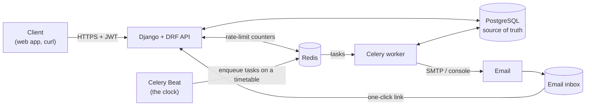
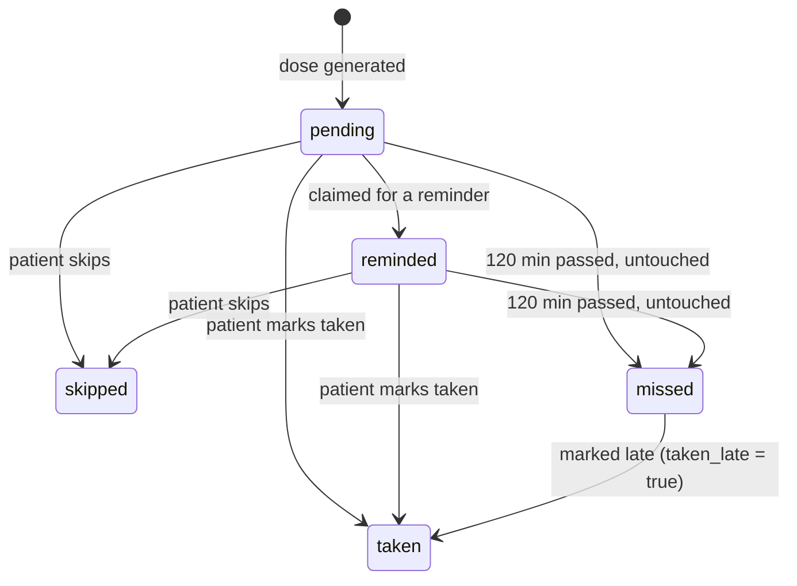

# 01. Overview: the problem, the people, the pitch and the architecture

## 1. The problem, from first principles

Many people take medicine on a schedule: "one tablet at 08:00 and one at 20:00, every day". Three things go
wrong in real life:

1. **People forget.** A reminder at the right moment helps.
2. **"8 am" is a local clock idea.** Someone in Kolkata and someone in New York both mean "8 on my wall
   clock". New York also changes its clocks twice a year (daylight saving time), Kolkata never does. A system
   that gets this wrong sends a reminder an hour late for half the year.
3. **Other people care, but privacy matters.** A son, a nurse or a doctor wants to know "is Dad taking his
   pills?" but only if Dad agrees, and Dad must be able to change his mind at any moment.

This backend solves those three problems: reminders by email at the right local time, an honest record of
what was taken, and an adherence report that is shared only with consent.

## 2. Users and roles

There are three roles. A user has exactly one (`accounts/models.py`, `Role`).

| Role | Who | What they can do |
|---|---|---|
| `patient` | The person taking medicine | Manage their own medications and schedules, see today's and upcoming doses, mark doses taken or skipped, invite caregivers and doctors, revoke access, read their own audit log and report |
| `caregiver` | A relative, nurse or helper | Accept an invitation from a patient, then read that patient's adherence report |
| `doctor` | A clinician | Same as a caregiver in this system |

The key rule, from `CLAUDE.md` and enforced in `accounts/access.py`: **a caregiver or doctor sees a patient's
data only after the patient grants access, and the patient can revoke it at any time.**

*From `accounts/models.py`, `Role`:*

```python
class Role(models.TextChoices):
    PATIENT = "patient", "Patient"
    CAREGIVER = "caregiver", "Caregiver"
    DOCTOR = "doctor", "Doctor"
```

## 3. Features (everything is in the code, nothing is aspirational)

| Feature | Where it lives |
|---|---|
| Register with email and password; patients also give an IANA timezone | `accounts/serializers.py` (`RegisterSerializer`) |
| Log in and get JWT access and refresh tokens; refresh an expired access token | `accounts/views.py`, `accounts/urls.py` |
| Edit your own profile and notification preferences | `accounts/views.py` (`MeView`) |
| Medications: create, list, edit, deactivate (never delete) | `medications/` |
| Schedules: several local times per day, chosen days of the week, a date range | `scheduling/models.py` (`Schedule`) |
| Dose generation: schedules become concrete dose rows in UTC, 7 days ahead | `scheduling/services.py` |
| Reminder emails with a signed one-click "mark as taken" link | `notifications/`, `scheduling/links.py` |
| Retries with back-off, recovery of stuck sends, "missed" marking | `notifications/services.py` |
| Patient actions: today's doses, upcoming doses, taken, skip | `scheduling/views.py` (`DoseViewSet`), `scheduling/dose_actions.py` |
| Notification channels interface (email real; SMS and WhatsApp are log-only stubs) | `notifications/channels.py` |
| Access sharing: invite by email, accept, revoke | `accounts/grants.py`, `accounts/access_views.py` |
| Adherence report with a clear definition, plus a streak | `reports/services.py`, `reports/views.py` |
| Audit log: who viewed a patient's data | `reports/audit.py`, `reports/models.py` |
| Weekly summary emails to the patient and active grantees | `reports/summary.py` |
| Rate limits on login, register, invite and the one-click link | `config/ratelimit.py` |
| Structured logs, health check, Swagger docs, demo data command | `config/logging_utils.py`, `config/health.py`, `/api/docs/`, `accounts/management/commands/seed_demo.py` |

There is also a React web frontend in `frontend/`. This guide covers the **backend only**.

## 4. The 30-second pitch

> "I built the backend for a medication reminder app with Django REST Framework, PostgreSQL, Celery and
> Redis. Patients enter their medicines with schedules in their own local time. Background jobs turn
> schedules into dose records in UTC, so 8 am stays 8 am across daylight saving, and email a reminder with a
> one-click 'taken' link. Caregivers and doctors can see an adherence report, but only for patients who
> invited them, and patients can revoke at any time. The interesting engineering is making reminders safe:
> never sent twice and never silently lost, using database constraints, row locks and idempotent tasks."

## 5. The 2-minute pitch

> "Medication adherence is a real problem: people forget, they travel across time zones, and the people who
> help them need information without invading their privacy. I built the backend for that.
>
> It is a Django 5 and Django REST Framework API on PostgreSQL. Patients register with an IANA timezone like
> Asia/Kolkata, add medications, and attach schedules. A schedule stores *local wall-clock times*, like 08:00
> and 20:00, not UTC. That is a deliberate choice: if I stored UTC, a New York patient's 08:00 would drift to
> 09:00 after the clocks change. Instead, a generation function converts local time to UTC for each future
> date using the patient's zone, and stores one row per dose. That function is idempotent, because the
> database has a unique constraint on schedule and time, so running it twice, or two workers running it at
> once, cannot create duplicates.
>
> A Celery Beat scheduler runs every minute. It claims doses that are due using `SELECT ... FOR UPDATE SKIP
> LOCKED`, so two workers never claim the same dose, and writes a notification log row with a lease token.
> A worker then sends the email. Retries use exponential back-off, and a crashed worker is recovered when
> its lease expires. I chose at-least-once delivery on purpose: for medication, a rare duplicate reminder is
> better than a lost one. The email contains a signed link that opens a confirmation page, and only the
> button's POST changes data, because email scanners prefetch links.
>
> Access control is consent based. A patient invites a caregiver or doctor by email; the invitation is
> addressed to an email, so the API can't be used to discover who has an account. Access is checked in the
> database on every request, never cached in the token, so revoking takes effect immediately, and every view
> of a patient's report is written to an audit log the patient can read.
>
> I tested it with 460 tests against a real PostgreSQL, including tests that race real threads, and CI runs
> on Python 3.12 and 3.13 with a coverage floor."

## 6. The architecture in plain words

### The big picture

There are **five moving parts**:

1. **The web API** (Django + Django REST Framework). It answers HTTP requests: log in, add a medication,
   mark a dose taken. It is the only part clients talk to.
2. **PostgreSQL**, the database and the source of truth. Every user, medication, schedule, dose and
   notification record lives here, together with the constraints that keep the data correct.
3. **Redis**, a fast in-memory store used for three jobs: the **message broker** (the queue of tasks for
   Celery), the **result backend**, and the **cache** that holds rate-limit counters. See `config/settings.py`.
4. **Celery workers**, separate processes that run tasks in the background (send an email, generate doses).
5. **Celery Beat**, a clock process that puts tasks on the queue on a timetable ("every minute, run
   `dispatch_reminders`").

Why a background system at all? A web request should answer in milliseconds. Sending an email can take
seconds or fail. Reminders must go out at a specific minute *even if nobody is using the API*. Only a
scheduler plus workers can do that.



The same picture as plain ASCII, in case your viewer does not render Mermaid:

```text
 client ---HTTP+JWT---> [ Django + DRF API ] <----> [ PostgreSQL ]
                              ^   |  ^
   email link (one click) ----+   |  +---- rate-limit counters ---- [ Redis ]
                                  |                                    ^   |
 [ Celery Beat ] --enqueue--------+------------------------------------+   |
 (the clock)                                                               v
                              [ Celery worker ] <---- tasks ---------------+
                                   |  ^
                                   v  |
                              [ PostgreSQL ]      worker --> SMTP/console --> inbox
```

### The two paths through the system

* **The request path** (foreground): client to API to database and back. Used for everything a person does.
* **The background path** (no one is waiting): Beat adds a task to Redis, a worker picks it up, works with
  PostgreSQL, and may send an email. Used for generating doses, reminders and weekly summaries.

### The four timetables

Beat reads `CELERY_BEAT_SCHEDULE` from `config/settings.py`. This is the whole "clock" of the system:

*From `config/settings.py`, `CELERY_BEAT_SCHEDULE`:*

```python
CELERY_BEAT_SCHEDULE = {
    "generate-upcoming-doses": {
        "task": "scheduling.tasks.generate_upcoming_doses",
        "schedule": crontab(minute=10, hour=0),  # daily, 00:10 UTC
    },
    "dispatch-reminders": {
        "task": "notifications.tasks.dispatch_reminders",
        "schedule": crontab(),  # every minute
    },
    "mark-missed-doses": {
        "task": "notifications.tasks.mark_missed_doses",
        "schedule": crontab(minute="*/5"),
    },
    "send-weekly-summaries": {
        "task": "reports.tasks.send_weekly_summaries",
        "schedule": crontab(minute=20),  # hourly; each patient's week ends at a different UTC time
    },
}
```

### The five Django apps

The code is split into Django "apps", each with one responsibility (this is a requirement in `CLAUDE.md`):

| App | Responsibility |
|---|---|
| `accounts` | Users, roles, patient profile (timezone), JWT login, access grants |
| `medications` | A patient's prescriptions |
| `scheduling` | Schedules, dose events, dose generation, taken/skip, the signed link |
| `notifications` | The reminder pipeline: claim, lease, send, retry, missed |
| `reports` | Adherence report, audit log, weekly summary |
| `config` (not an app) | Settings, Celery app, health check, rate limits, logging |

### A rule that shapes everything: UTC inside, local at the edges

All datetimes are stored in UTC (`TIME_ZONE = "UTC"` and `USE_TZ = True` in `config/settings.py`). A patient's
*local* time only appears (a) in the schedule definition, (b) when converting to UTC to generate doses, and
(c) when showing times back to the patient. Chapter 06 is entirely about this.

## 7. Three key user journeys, step by step

Everything below was run for real against the code (output shown where useful).

### Journey A: a patient gets set up

1. **Register.** `POST /api/auth/register/` with email, password, role and timezone.
   `RegisterSerializer.create` (`accounts/serializers.py`) creates the `User` and, for patients, a
   `PatientProfile` holding the timezone, inside one `transaction.atomic()`.
2. **Log in.** `POST /api/auth/login/` returns an `access` token (30 minutes) and a `refresh` token (7 days).
3. **Add a medication.** `POST /api/medications/` with name, dosage and a start date.
   `MedicationViewSet.perform_create` attaches the logged-in patient. The patient cannot set `patient` or
   `is_active` themselves; those fields are read-only.
4. **Add a schedule.** `POST /api/medications/<id>/schedules/` with `times_of_day: ["08:00", "20:00"]`.
5. **Doses appear automatically.** Saving a `Schedule` fires a Django `post_save` signal
   (`scheduling/signals.py`, `schedule_saved`), which calls `sync_schedule_events`. That creates `DoseEvent`
   rows for the next 7 days. In my run, a 2-times-a-day schedule produced its future doses immediately, with
   no extra API call. Beat's daily job keeps topping them up.

Real results from running steps 1 and 2 (shortened):

```text
register -> 201 {"id": 55, "email": "learner@example.com", "role": "patient",
                 "patient_profile": {"timezone": "Asia/Kolkata", ...}}
login wrong password -> 401 {"detail": "No active account found with the given credentials"}
login ok -> 200 keys: ['access', 'refresh']
```

### Journey B: a reminder reaches the patient and the dose is taken

This is the heart of the system. Chapter 06 covers dose generation; the sending side is summarised here and is
documented in the big comment at the top of `notifications/services.py`.

1. **Beat tick, every minute.** Beat enqueues `dispatch_reminders` (`notifications/tasks.py`).
2. **Claim.** `claim_due_doses` (`notifications/services.py`) locks pending doses that are due within
   `[now - 60 minutes, now + 60 seconds]` using `select_for_update(skip_locked=True)`. In the same transaction
   it flips each dose from `pending` to `reminded` and inserts a `NotificationLog` row with status `sending`
   and a fresh `lease_token`. The unique constraint `(dose_event, channel)` means a dose can be claimed once
   per channel.
3. **Deliver.** For every claim, `deliver_notification` runs. `deliver` first *swaps the lease token* with one
   conditional `UPDATE`. Only one caller can win that swap, so duplicate or retried tasks send nothing. The
   email is sent with no database lock held.
4. **Record.** On success the log becomes `sent` and the dose gets `reminder_sent_at`. On failure, a retry is
   scheduled with exponential back-off; after 5 attempts the log becomes `failed`.
5. **The email.** It is rendered in the patient's local time and contains a signed link
   (`scheduling/links.py`).
6. **The click.** `GET` on the link shows a confirmation page and changes nothing (email scanners prefetch
   links). Pressing the button does a `POST`, which calls `mark_taken` and records `taken_at`.
7. **If the patient never acts,** `mark_missed_doses` (every 5 minutes) marks the dose `missed` after 120
   minutes. A missed dose can still be marked taken later; it is then flagged `taken_late`.

Real results from running this journey (only my test dose, in a rolled-back transaction):

```text
1. dose status: pending
2. after dispatch -> dose: reminded | log: sending attempts 0
   second dispatch makes no new claim: 0
3. deliver -> sent | log: sent attempts 1 | emails: 1
   deliver again with the same token -> skipped | emails still: 1
   Subject: Medication reminder: Metformin
   | It's time to take Metformin (500 mg).
   | Scheduled for 12:56 on Thu 26 Nov 2026 (IST).
   | Instructions: With food
   | Mark it as taken (one click): http://localhost:8000/dose/taken/<signed-token>
4. GET the link -> 200 | dose still: reminded (a GET never changes anything)
   POST the link -> 200 | dose: taken | taken_late: False
```

Notice the two idempotency proofs: dispatching twice made no second claim, and delivering twice with the same
token sent one email.

The dose's life as a state machine (verified against `claim_due_doses`, `mark_missed_doses`, and
`scheduling/dose_actions.py`):



### Journey C: a doctor views a report, then loses access

1. **Invite.** The patient calls `POST /api/access/grants/` with the doctor's email.
   `grants.invite` (`accounts/grants.py`) stores an `AccessGrant` with status `pending`. The answer is the
   same fixed sentence whether or not that email has an account (so the API can't be used to find out who is
   registered).
2. **Before accepting, no access.** The doctor asking for the report gets `404`.
3. **Accept.** The doctor sees the invitation in `GET /api/access/invitations/` (matched by email) and calls
   `POST /api/access/invitations/<id>/accept/`. The grant becomes `active`.
4. **View.** `GET /api/reports/adherence/?patient=<id>` returns the report. `resolve_patient`
   (`accounts/access.py`) checks the grant **in the database on this request**, and an `AuditLog` row is
   written *before* any data is returned.
5. **Patient reads the log.** `GET /api/audit-log/` shows who looked and when.
6. **Revoke.** `POST /api/access/grants/<id>/revoke/`. On the very next request the doctor gets `404`.

Real results:

```text
1 patient invites doctor    -> 202 {"detail": "Invitation recorded. Access starts only if that person accepts ...
  doctor tries report now   -> 404 (no grant yet)
2 doctor sees invitations   -> [(50, 'p6@example.com')]
  doctor accepts            -> active
3 doctor views report       -> 200 keys: ['current_streak', 'definition', 'generated_at', 'medications', 'patient', 'range', 'totals']
  audit rows written        -> 1 | viewer_email: d6@example.com
  patient reads audit log   -> 1 entry; d6@example.com report_view
4 patient revokes           -> revoked
  doctor report again       -> 404 {"detail": "Not found."}
```

## 8. Where things live (a map for opening files)

```text
config/            settings, Celery app, health check, rate limiters, logging, env helpers
accounts/          User, PatientProfile, AccessGrant, JWT views, permissions, grants logic
medications/       Medication model, serializer, viewset
scheduling/        Schedule and DoseEvent, generation services, signals, dose actions, signed links
notifications/     NotificationLog, channels, the claim/deliver/retry pipeline
reports/           adherence report, audit log, weekly summary
conftest.py        shared pytest fixtures
*/tests/           tests for each app; tests/ for cross-cutting ones
```

## Interview questions on this chapter

1. **Q: Why do you need Celery and Redis? Why not do it in the web request?**
   **A:** A web request is for answering a person quickly. Reminders must go out at a specific minute even
   when nobody is calling the API, and sending an email can be slow or fail. So a clock (Beat) puts tasks on a
   queue (Redis) and workers run them in the background, with retries. It also lets me add workers to scale
   sending without touching the API.

2. **Q: What does each component do: API, PostgreSQL, Redis, worker, Beat?**
   **A:** The API handles HTTP. PostgreSQL is the source of truth and enforces constraints. Redis is the
   broker and result backend for Celery and also holds rate-limit counters (the Django cache). A worker runs
   tasks. Beat is only a timer that enqueues tasks on a schedule; it does no work itself.

3. **Q: A caregiver wants a patient's report. What must be true?**
   **A:** The patient invited the caregiver's email, the caregiver has an account with that email and the
   caregiver or doctor role, accepted, and the grant is still `active`. That is checked in the database on
   every request (`accounts/access.py`), not stored in the JWT, so a revoke works immediately.

4. **Q: Why is "no access" a 404 and not a 403?**
   **A:** A 403 would confirm that the patient exists. Using 404 for both "no such patient" and "you have no
   grant" means the API cannot be used to enumerate patient ids. The same thinking is behind the invite
   endpoint returning one fixed message for every valid email.

5. **Q: Explain at-least-once delivery and why you chose it.**
   **A:** Every due reminder is sent at least once, and in one narrow case twice: the email provider accepted
   the message and then the worker died before recording `sent`. When the lease expires, recovery resends it
   with the same Message-ID. I chose that over at-most-once because a lost reminder for medication is worse
   than a rare duplicate.

6. **Q: How do you stop two workers sending the same reminder?**
   **A:** Three layers. Claiming uses `SELECT ... FOR UPDATE SKIP LOCKED` in a transaction that also flips
   the dose to `reminded`. The unique constraint on `(dose_event, channel)` makes a double claim impossible
   at the database level. And sending needs to swap a one-time `lease_token` using one conditional `UPDATE`,
   so only one caller wins even if the task is delivered twice.

7. **Q: Why does clicking the email link not mark the dose taken immediately?**
   **A:** Mail scanners and link previews automatically fetch URLs with `GET`. If `GET` changed data, a
   scanner could mark doses taken. So `GET` only shows a page; the button does a `POST`
   (`dose_link` in `scheduling/views.py`).

8. **Q: What does "idempotent" mean here? Give two examples.**
   **A:** Doing it twice has the same effect as once. Dose generation: the unique constraint plus
   `bulk_create(ignore_conflicts=True)` mean generating again creates nothing. Marking taken: a second call
   returns the dose unchanged. Also reminder delivery with a used lease token returns `skipped`.

9. **Q: What are the three user roles and how are they stored?**
   **A:** `patient`, `caregiver`, `doctor`, stored as a string column `role` on `User`, with Django
   `TextChoices` giving the allowed values. Permission classes in `accounts/permissions.py` check it.

10. **Q: What would you check if a reminder never arrived?**
    **A:** The dose's status, then its `NotificationLog` (status, attempts, error, `next_attempt_at`), then the
    structured log lines, then whether Beat and a worker are running, and finally the patient's notification
    preferences (a channel switched off means the dose is left pending).

## Common mistakes to avoid

* **Saying "Celery sends the reminders" without Beat.** Celery runs tasks; **Beat** decides *when*. Both
  processes must run.
* **Describing the dose as "a cron job per patient".** There is one global minute tick that claims all due
  doses in a batch.
* **Saying JWT contains the permissions.** The role is in the token as information, but access to patient
  data is checked in the database each time. Chapter 04 shows a test that changed a role in the database and
  got a 403 with the *same* token.
* **Saying the system never sends duplicates.** The honest answer is "at-least-once, with one documented
  narrow window". Overclaiming is a red flag.
* **Mixing up the two time ideas.** A schedule holds local wall-clock times; a dose row holds one UTC instant.
* **Forgetting that GET must be safe.** Any link opened from an email must not change data on `GET`.
