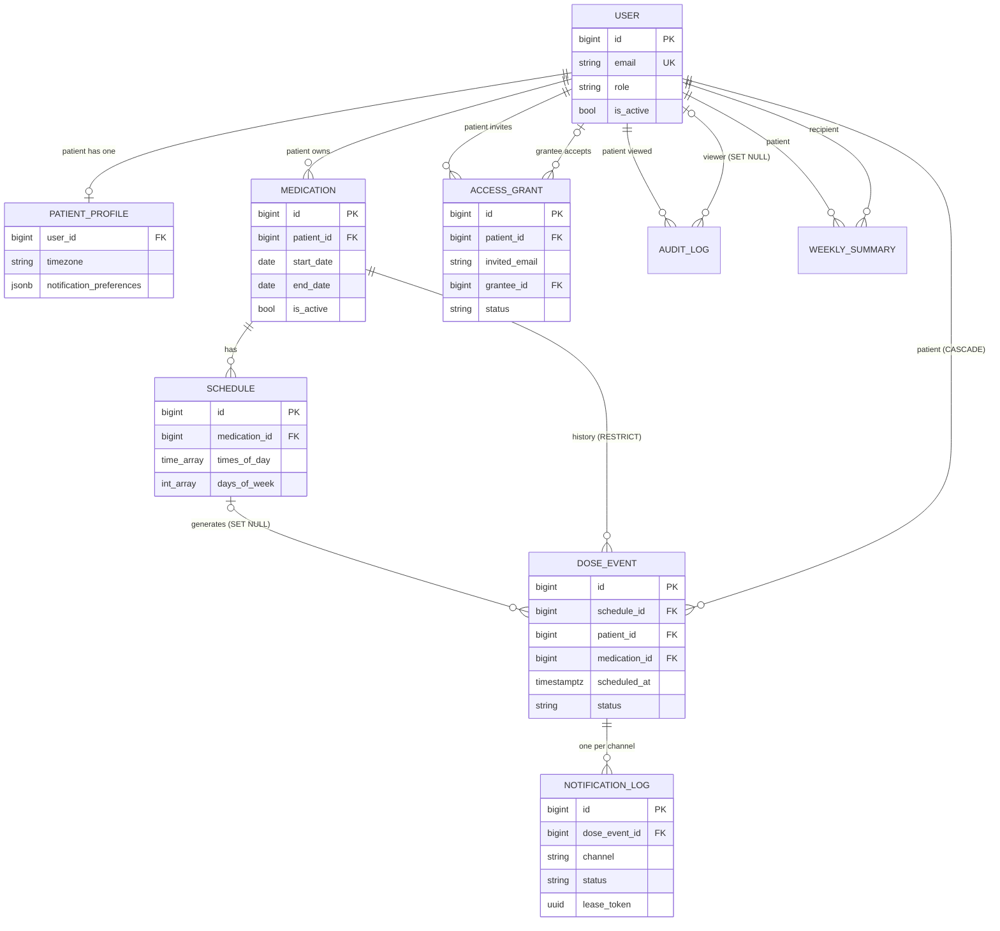
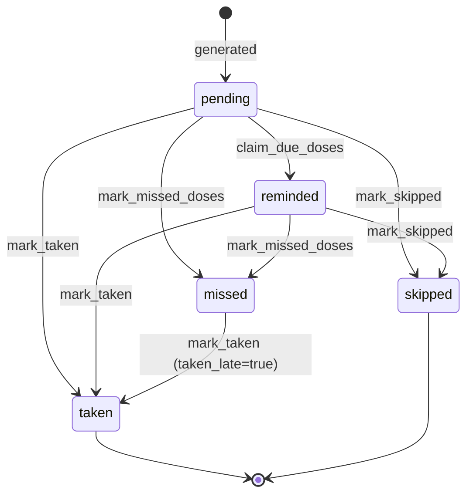
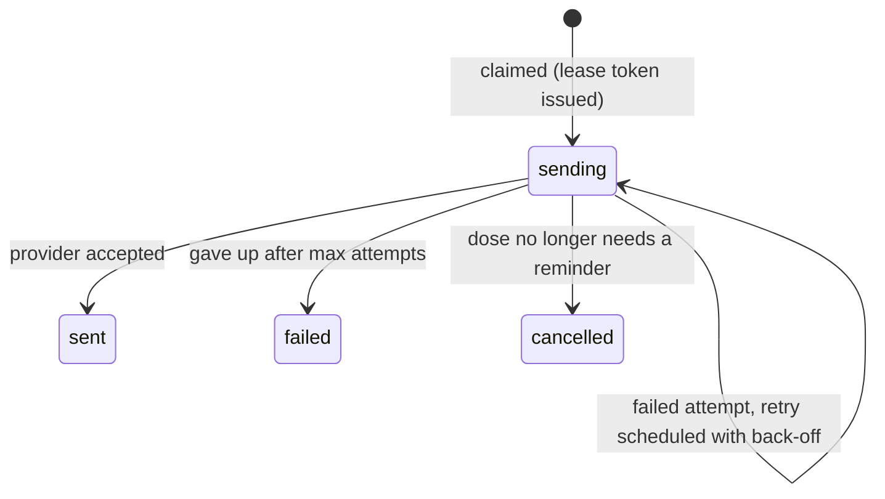

# 03. The data model: every table, field, constraint, index and relationship

## 1. First principles: what a database model is

A **relational database** stores data in **tables**. A table has **columns** (the kinds of facts) and **rows**
(one record each). Django lets you describe a table as a Python class, a **model**; each class attribute is a
column. A **migration** is a generated file that applies the change to the real database
(`python manage.py migrate`). This project has 11 migration files under `*/migrations/`.

Ideas you need before reading the tables:

* **Primary key (PK).** A column that uniquely identifies a row. Here every table has an `id` of type
  `bigint` (`DEFAULT_AUTO_FIELD = "django.db.models.BigAutoField"` in `config/settings.py`).
* **Foreign key (FK).** A column holding another table's `id`, linking rows ("this medication belongs to
  patient 7").
* **Relationship kinds.** *One-to-many* (a patient has many medications), *one-to-one* (a user has at most
  one profile), *many-to-many* (not used for our own tables).
* **`on_delete`.** What happens to child rows when the parent is deleted: `CASCADE` (delete children too),
  `SET_NULL` (keep them, clear the link), `RESTRICT` (refuse to delete the parent).
* **Constraint.** A rule the *database* enforces: `UNIQUE`, `CHECK`, `NOT NULL`, foreign keys.
* **Index.** A side structure that makes lookups fast, like the index at the back of a book. Indexes cost
  space and slow writes slightly, so we add only the ones the queries need.
* **Validation vs constraint.** Validation is Python code that checks input (a serializer says "end date
  cannot be before start date"). A constraint is the database refusing bad data **even if the Python code has
  a bug, or two requests arrive at the same moment**. This project uses both, on purpose.

### Why constraints in the database and not only in Python?

Imagine "a dose must exist only once per schedule and time". If Python checks "does it exist? no, then insert",
two workers can both check at the same instant, both see "no", and both insert, giving a duplicate. That is a
**race condition**. A `UNIQUE` constraint cannot be raced: the database rejects the second insert. So the real
safety lives in the database, and the Python code is the friendly layer on top.

### An important fact I verified: `on_delete` is implemented by Django, not by PostgreSQL

I queried PostgreSQL's `pg_constraint` for every foreign key in this project. All of them report
`confdeltype = 'a'` (**NO ACTION**), even the ones declared `CASCADE`, `SET_NULL` or `RESTRICT`. That is how
Django works: when you call `.delete()`, **Django's ORM** finds the related rows and deletes or updates them
itself, in Python, in one transaction. The database foreign key only guarantees that no row points at a row
that does not exist (checked at commit time).

What this means in practice:

* Deleting through the ORM or the admin behaves as the model says.
* A raw `DELETE FROM accounts_user WHERE ...` typed in `psql` does **not** cascade; it fails at commit if
  children exist. Interviewers sometimes ask this.
* Django's `RESTRICT` is raised in Python as an error before anything is deleted.

## 2. The tables at a glance

There are nine tables of our own, plus Django's built-in ones (`django_migrations`, `django_content_type`,
`auth_permission`, `auth_group`, sessions, admin log, and the two many-to-many link tables for users' groups and
permissions).

| Table | Model | App | One row is... |
|---|---|---|---|
| `accounts_user` | `User` | accounts | An account (patient, caregiver or doctor) |
| `accounts_patientprofile` | `PatientProfile` | accounts | A patient's settings, including the timezone |
| `accounts_accessgrant` | `AccessGrant` | accounts | One invitation or permission from a patient to an email |
| `medications_medication` | `Medication` | medications | A prescription owned by a patient |
| `scheduling_schedule` | `Schedule` | scheduling | "Take this at these local times on these days" |
| `scheduling_doseevent` | `DoseEvent` | scheduling | One concrete dose at one UTC instant |
| `notifications_notificationlog` | `NotificationLog` | notifications | One reminder for one dose on one channel, and its attempts |
| `reports_auditlog` | `AuditLog` | reports | A record that someone viewed a patient's data |
| `reports_weeklysummary` | `WeeklySummary` | reports | One weekly summary email to one recipient for one week |

## 3. The ER (entity-relationship) diagram



Read it as sentences: "One user (a patient) owns many medications. A medication has many schedules. A
schedule generates many dose events. A dose event has at most one notification log per channel."

## 4. `User` (`accounts_user`)

*From `accounts/models.py`, `User`:*

```python
class User(AbstractBaseUser, PermissionsMixin):
    email = models.EmailField(unique=True)
    full_name = models.CharField(max_length=150, blank=True)
    role = models.CharField(max_length=20, choices=Role.choices, default=Role.PATIENT)
    is_active = models.BooleanField(default=True)
    is_staff = models.BooleanField(default=False)
    date_joined = models.DateTimeField(auto_now_add=True)

    USERNAME_FIELD = "email"
    REQUIRED_FIELDS: list[str] = []

    objects = UserManager()
```

| Column | Type in PostgreSQL | Null? | Why |
|---|---|---|---|
| `id` | bigint | no | Primary key |
| `password` | varchar(128) | no | A *hash*, never the plain password (from `AbstractBaseUser`) |
| `last_login` | timestamptz | yes | Django built-in |
| `is_superuser` | boolean | no | Django admin permissions (from `PermissionsMixin`) |
| `email` | varchar(254) | no | The login name; **unique** |
| `full_name` | varchar(150) | no (blank allowed) | Display name |
| `role` | varchar(20) | no | `patient`, `caregiver` or `doctor`; default patient |
| `is_active` | boolean | no | False blocks login and API use |
| `is_staff` | boolean | no | May enter the Django admin |
| `date_joined` | timestamptz | no | Set automatically on creation |

**Constraint:** `accounts_user_email_key` is `UNIQUE (email)`. **Design reasons:**

* **Email as the username** (`USERNAME_FIELD = "email"`): people remember their email; the project has no
  separate username.
* **A custom user model from day one.** Django strongly advises this; changing the user model after the first
  migration is painful. `AUTH_USER_MODEL = "accounts.User"` in settings.
* **Role is a column, not a group.** With only three fixed roles, a string column with `choices` is simpler
  than Django's group/permission tables.
* **Email is lowercased by `UserManager._create`** (`self.normalize_email(email).lower()`), and
  `RegisterSerializer.validate_email` also checks `email__iexact`. Note the database `UNIQUE` is
  case-sensitive on its own, so the lowercase rule is what keeps `A@x.com` and `a@x.com` from being two
  accounts. Creating a user around the manager would bypass it.

## 5. `PatientProfile` (`accounts_patientprofile`)

*From `accounts/models.py`, `PatientProfile`:*

```python
class PatientProfile(models.Model):
    """Per-patient settings. The timezone drives all schedule calculations."""

    user = models.OneToOneField(
        User, on_delete=models.CASCADE, related_name="patient_profile"
    )
    timezone = models.CharField(
        max_length=64, default="UTC", validators=[validate_iana_timezone]
    )
    phone_number = models.CharField(max_length=20, blank=True)
    notification_preferences = models.JSONField(default=default_notification_preferences)
```

| Column | Type | Null? | Why |
|---|---|---|---|
| `id` | bigint | no | PK |
| `user_id` | bigint | no | **One-to-one** with `User`; `CASCADE`: deleting the user deletes the profile |
| `timezone` | varchar(64) | no | An IANA name such as `Asia/Kolkata`; default `UTC` |
| `phone_number` | varchar(20) | no (blank allowed) | For future SMS/WhatsApp; not used for email |
| `notification_preferences` | jsonb | no | `{"email": true, "sms": false, "whatsapp": false}` by default |

**Design reasons:**

* **Why a separate table and not columns on `User`?** Only patients have a timezone. A caregiver or doctor
  has no profile row at all (`RegisterSerializer.create` creates it only `if user.role == Role.PATIENT`). That
  keeps the `User` table identical for all roles.
* **Why a string timezone and not a numeric offset?** An offset such as `-05:00` is only true for part of the
  year in New York. The *name* knows the daylight saving rules. Chapter 06.
* **Why `validate_iana_timezone` appears both on the model and in the serializers.** Django model validators
  run on `full_clean()` and in forms, **not automatically on `save()`**. So the API serializers also list the
  validator explicitly (`PatientProfileSerializer`, `RegisterSerializer`). I checked: registering with
  timezone `IST` is rejected with `'IST' is not a valid IANA timezone (e.g. Asia/Kolkata).`
* **Why JSON for preferences?** The set of channels (email, sms, whatsapp) may grow; a JSON object avoids a
  schema change for each new channel. `validate_preferences` (`accounts/serializers.py`) allows only known
  keys with boolean values, so the flexibility is controlled.

## 6. `AccessGrant` (`accounts_accessgrant`)

A patient's permission for someone to read their data. It is the heart of the consent model.

*From `accounts/models.py`, `AccessGrant.Meta.constraints`:*

```python
        constraints = [
            # At most one pending-or-active grant per patient and grantee.
            models.UniqueConstraint(
                fields=["patient", "invited_email"],
                condition=Q(status__in=["pending", "active"]),
                name="one_open_grant_per_patient_and_email",
            ),
            models.CheckConstraint(
                condition=Q(invited_email=Lower("invited_email")), name="grant_email_lowercase"
            ),
            models.CheckConstraint(
                condition=~Q(status="active") | Q(grantee__isnull=False),
                name="active_grant_has_grantee",
            ),
            models.CheckConstraint(
                condition=~Q(status="revoked") | Q(revoked_at__isnull=False),
                name="revoked_grant_has_timestamp",
            ),
        ]
```

| Column | Type | Null? | Why |
|---|---|---|---|
| `patient_id` | bigint FK to user | no | Who gave consent; `CASCADE` |
| `invited_email` | varchar(254) | no | **The invitation is addressed to an email, not a user** |
| `grantee_id` | bigint FK to user | **yes** | Filled in only when a matching account accepts; `CASCADE` |
| `status` | varchar(10) | no | `pending`, `active`, `revoked`; default `pending` |
| `created_at` | timestamptz | no | When invited |
| `accepted_at` | timestamptz | yes | When accepted |
| `revoked_at` | timestamptz | yes | When revoked |

**Constraints (verified in PostgreSQL), in plain words:**

| Name | Rule | Protects against |
|---|---|---|
| `one_open_grant_per_patient_and_email` | Unique on `(patient, invited_email)` **only where status is pending or active** (a *partial* unique index) | Two simultaneous invites creating two grants, while still allowing history |
| `grant_email_lowercase` | `invited_email = lower(invited_email)` | `A@x.com` vs `a@x.com` mismatches |
| `active_grant_has_grantee` | If status is `active`, `grantee_id` is not null | An active grant with nobody on the other end |
| `revoked_grant_has_timestamp` | If status is `revoked`, `revoked_at` is not null | A revoke with no record of when |

**Indexes:** `grant_grantee_status_idx (grantee_id, status)` serves "which patients can this caregiver see?"
(`accessible_patients`); `grant_email_status_idx (invited_email, status)` serves "which pending invitations
are addressed to my email?" (`InvitationListView`). Foreign keys also get automatic indexes.

**Why the partial unique constraint is clever.** A plain unique on `(patient, invited_email)` would forbid
ever inviting the same person again after revoking. The partial version applies only to *open* grants, so a
patient can revoke and later invite again, and revoked rows stay as history. The test
`test_simultaneous_invites_create_exactly_one_grant` races real threads against it.

**Why `invited_email` and not a link to a user?** If the invitation pointed at a user row, the API would
reveal whether an account exists. By addressing an email, inviting an address with no account and inviting a
registered one look identical (chapter 04).

## 7. `Medication` (`medications_medication`)

*From `medications/models.py`, `Medication.Meta`:*

```python
    class Meta:
        ordering = ["-is_active", "name", "id"]
        constraints = [
            models.CheckConstraint(
                condition=Q(end_date__isnull=True) | Q(end_date__gte=F("start_date")),
                name="medication_end_not_before_start",
            ),
        ]
```

| Column | Type | Null? | Why |
|---|---|---|---|
| `patient_id` | bigint FK | no | Owner; `CASCADE` |
| `name` | varchar(200) | no | e.g. "Metformin" |
| `dosage` | varchar(200) | no | Free text such as `500 mg` or `2 tablets` (strengths vary too much to model) |
| `instructions` | text | no (blank allowed) | "Take with food" |
| `start_date` | date | no | First local date it applies |
| `end_date` | date | yes | Last local date, inclusive; `NULL` means open-ended |
| `is_active` | boolean | no | `False` once stopped. There is **no delete** |
| `created_at`, `updated_at` | timestamptz | no | Audit-style timestamps |

**Why `date` and not `datetime` for start/end?** They are *calendar dates in the patient's timezone*
("until 31 December"), not instants.

**Why no delete?** `MedicationViewSet` allows only `get`, `post`, `patch` (`http_method_names`), and the
`DoseEvent.medication` foreign key is `RESTRICT`. History must survive (chapter 05, 06). Ordering puts active
medications first.

## 8. `Schedule` (`scheduling_schedule`)

*From `scheduling/models.py`, `Schedule`:*

```python
    medication = models.ForeignKey(
        Medication, on_delete=models.CASCADE, related_name="schedules"
    )
    times_of_day = ArrayField(models.TimeField(), help_text="Local wall-clock times.")
    days_of_week = ArrayField(
        models.SmallIntegerField(), default=default_days_of_week,
        help_text="0=Monday .. 6=Sunday. Defaults to every day.",
    )
    start_date = models.DateField()
    end_date = models.DateField(
        null=True, blank=True, help_text="Inclusive, as a date in the patient's timezone."
    )
    is_active = models.BooleanField(default=True)
```

| Column | Type | Null? | Why |
|---|---|---|---|
| `medication_id` | bigint FK | no | `CASCADE`. A medication can have several schedules |
| `times_of_day` | `time[]` | no | **Local wall-clock** times, no timezone. Chapters 05 and 06 |
| `days_of_week` | `int2[]` | no | `0=Monday ... 6=Sunday`, default all seven (matches Python's `weekday()`) |
| `start_date` / `end_date` | date | no / yes | Local dates; end inclusive |
| `is_active` | boolean | no | Pausing a schedule without deleting it |

**Constraint:** `schedule_end_not_before_start`: `end_date IS NULL OR end_date >= start_date`.

**Why arrays?** `ArrayField` (PostgreSQL only) keeps "08:00, 20:00" in one column of one row. The
alternative is a child table `ScheduleTime(schedule, time)`. The array is simpler to read and write for a short
list that is always handled as a whole, at the cost of not being able to easily index or constrain individual
elements. That trade-off is fine here because the list has at most a handful of entries.

## 9. `DoseEvent` (`scheduling_doseevent`)

The most important table. **One row = one concrete dose at one UTC instant.**

*From `scheduling/models.py`, `DoseEvent` foreign keys:*

```python
    schedule = models.ForeignKey(
        Schedule, null=True, blank=True, on_delete=models.SET_NULL, related_name="dose_events"
    )
    patient = models.ForeignKey(
        settings.AUTH_USER_MODEL, on_delete=models.CASCADE, related_name="dose_events"
    )
    # RESTRICT: a medication with dose history cannot be deleted on its own
    # (deactivate it instead), but deleting the whole patient account still
    # cascades, because the doses are deleted in the same operation.
    medication = models.ForeignKey(
        Medication, on_delete=models.RESTRICT, related_name="dose_events"
    )
```

| Column | Type | Null? | Why |
|---|---|---|---|
| `schedule_id` | bigint FK | **yes** | `SET_NULL`: if a schedule is deleted, its doses stay (history) |
| `patient_id` | bigint FK | no | **Stored directly** so history survives and queries need no join; `CASCADE` |
| `medication_id` | bigint FK | no | `RESTRICT`: a medication with doses cannot be deleted |
| `scheduled_at` | timestamptz | no | The UTC instant of the dose |
| `status` | varchar(10) | no | `pending`, `reminded`, `taken`, `missed`, `skipped` |
| `reminder_sent_at` | timestamptz | yes | When the reminder email was sent |
| `taken_at` | timestamptz | yes | When the patient marked it taken |
| `missed_at` | timestamptz | yes | When the system marked it missed |
| `taken_late` | boolean | no | Taken after it had become missed |
| `created_at` | timestamptz | no | Row creation time |

**Constraint:** `unique_dose_per_schedule_time` is `UNIQUE (schedule_id, scheduled_at)`. This is what makes
generation idempotent (chapter 06). In PostgreSQL, `NULL`s are never equal in a unique constraint, so rows
whose schedule was deleted (`schedule_id IS NULL`) never conflict with anything (the model docstring says so).

**Why store `patient` and `medication` on the dose when `schedule` already leads to them?** Because
`schedule` can become `NULL`. The dose must still know whose it is and what medicine it was. It also makes the
most common query, "this patient's doses between two instants", a single-table lookup.

**Indexes** (verified, with the exact definitions PostgreSQL reports):

*From `scheduling/models.py`, `DoseEvent.Meta.indexes`:*

```python
        indexes = [
            # Hot path, every minute: "open" doses that are due. Partial, so it holds only the
            # few upcoming doses (tiny) instead of the whole history, and the claim and the
            # missed-dose job no longer scan per patient.
            models.Index(
                fields=["scheduled_at"], name="dose_open_idx",
                condition=Q(status__in=["pending", "reminded"]),
            ),
            # A patient's doses in a time range (today / upcoming / reports). INCLUDE carries the
            # columns the report aggregates, so the report is an index-only scan.
            models.Index(
                fields=["patient", "scheduled_at"], name="dose_patient_cover_idx",
                include=["status", "medication", "taken_late"],
            ),
            # "Latest missed dose" for the streak, constant time even for patients who never miss.
            models.Index(
                fields=["patient", "scheduled_at"], name="dose_patient_missed_idx",
                condition=Q(status="missed"),
            ),
        ]
```

| Index | Definition (PostgreSQL) | Used by |
|---|---|---|
| `dose_open_idx` | `btree (scheduled_at) WHERE status IN ('pending','reminded')` | The every-minute claim and the missed-dose job |
| `dose_patient_cover_idx` | `btree (patient_id, scheduled_at) INCLUDE (status, medication_id, taken_late)` | Today, upcoming and the adherence report |
| `dose_patient_missed_idx` | `btree (patient_id, scheduled_at) WHERE status = 'missed'` | The streak calculation |
| `unique_dose_per_schedule_time` | `btree (schedule_id, scheduled_at)` | Uniqueness and lookups per schedule |

**Partial index** = an index over only the rows that match a condition. The table grows forever (history),
but only a tiny fraction is "open". Indexing only those rows keeps the hot every-minute query tiny and fast.
**Covering index (`INCLUDE`)** = the index also carries extra columns, so the database can answer a query
from the index alone without visiting the table.

### The dose lifecycle (state machine)



`taken` and `skipped` are final: `mark_skipped` rejects a taken dose with a 409, and the missed-dose job only
touches `pending` and `reminded` rows (`scheduling/dose_actions.py`, `notifications/services.py`).

## 10. `NotificationLog` (`notifications_notificationlog`)

One reminder for one dose on one channel, and every attempt to send it.

*From `notifications/models.py`, `NotificationLog.Meta`:*

```python
    class Meta:
        ordering = ["created_at", "id"]
        constraints = [
            models.UniqueConstraint(
                fields=["dose_event", "channel"], name="unique_notification_per_dose_channel"
            ),
        ]
        indexes = [
            # Only unfinished sends are ever scanned (retries / stuck leases). Partial, so the
            # millions of finished rows are not in the index and finishing a send removes its entry.
            models.Index(
                fields=["next_attempt_at"], name="notif_sending_idx",
                condition=Q(status="sending"),
            ),
        ]
```

| Column | Type | Null? | Why |
|---|---|---|---|
| `dose_event_id` | bigint FK | no | `CASCADE` |
| `channel` | varchar(20) | no | `email`, `sms`, `whatsapp` |
| `status` | varchar(10) | no | `sending`, `sent`, `failed`, `cancelled` |
| `attempts` | smallint | no (>= 0) | How many sends were tried |
| `error` | text | no | Last error text (blank if none) |
| `lease_token` | uuid | yes | A one-time token proving *this* worker may send now |
| `lease_until` | timestamptz | yes | When that permission expires |
| `next_attempt_at` | timestamptz | no | When a retry is due |
| `last_attempt_at`, `sent_at`, `created_at` | timestamptz | yes, yes, no | Timeline |

**Why this table exists at all.** It is the reliability ledger: the `UNIQUE (dose_event, channel)` constraint
means a dose can be claimed once per channel; the **lease** (`lease_token`, `lease_until`) says which worker
may send right now. Chapter 01 describes the flow, and the docstring at the top of `notifications/services.py`
is the full explanation.



## 11. `AuditLog` (`reports_auditlog`)

*Who looked at a patient's data, and when.* Written when a caregiver or doctor views a report or is emailed a
weekly summary.

| Column | Type | Null? | Why |
|---|---|---|---|
| `patient_id` | bigint FK | no | Whose data; `CASCADE` |
| `viewer_id` | bigint FK | **yes** | `SET_NULL`: if the viewer's account is later deleted, the row stays |
| `viewer_email`, `viewer_role` | varchar | no | **Copied** onto the row so the history stays meaningful after deletion |
| `action` | varchar(20) | no | `report_view` or `weekly_summary` |
| `range_start`, `range_end` | date | no | Local dates the report covered |
| `created_at` | timestamptz | no | When |

**Index:** `audit_patient_time_idx (patient_id, created_at DESC)` serves "newest entries for this patient"
(`AuditLogListView`). Rows are **append-only**: nothing in the app updates or deletes them. Copying the email
and role is a standard audit technique: an audit record should not change meaning when other data changes.

## 12. `WeeklySummary` (`reports_weeklysummary`)

One weekly summary email for one patient, week and recipient.

| Column | Type | Null? | Why |
|---|---|---|---|
| `patient_id`, `recipient_id` | bigint FKs | no | Whose week; who receives it |
| `week_start`, `week_end` | date | no | Monday and Sunday in the patient's timezone |
| `status` | varchar(10) | no | `sending`, `sent`, `failed`, `cancelled` |
| `attempts` | smallint | no (>= 0) | Retry counter |
| `error`, `created_at`, `sent_at` | text, timestamptz, timestamptz | no, no, yes | Bookkeeping |

**Constraints:** `unique_summary_per_week_recipient` is `UNIQUE (patient, week_start, recipient)`, and
`summary_week_ordered` is `week_end >= week_start`. The unique constraint is the idempotency device: the row is
inserted **before** sending, so a second run cannot claim it again (documented in `reports/summary.py`).

## 13. Verified by running: the real constraints and indexes in PostgreSQL

I listed them straight from the database (`pg_constraint`, `pg_indexes`). A selection:

```text
CONSTRAINT accounts_accessgrant | active_grant_has_grantee | CHECK (((NOT ((status)::text = 'active'::text)) OR (grantee_id IS NOT NULL)))
CONSTRAINT accounts_accessgrant | grant_email_lowercase | CHECK (((invited_email)::text = lower((invited_email)::text)))
CONSTRAINT accounts_user | accounts_user_email_key | UNIQUE (email)
CONSTRAINT medications_medication | medication_end_not_before_start | CHECK (((end_date IS NULL) OR (end_date >= start_date)))
CONSTRAINT notifications_notificationlog | unique_notification_per_dose_channel | UNIQUE (dose_event_id, channel)
CONSTRAINT reports_weeklysummary | unique_summary_per_week_recipient | UNIQUE (patient_id, week_start, recipient_id)
CONSTRAINT scheduling_doseevent | unique_dose_per_schedule_time | UNIQUE (schedule_id, scheduled_at)
INDEX scheduling_doseevent | dose_open_idx | btree (scheduled_at) WHERE (status IN ('pending','reminded'))
INDEX scheduling_doseevent | dose_patient_cover_idx | btree (patient_id, scheduled_at) INCLUDE (status, medication_id, taken_late)
INDEX notifications_notificationlog | notif_sending_idx | btree (next_attempt_at) WHERE (status = 'sending')
INDEX reports_auditlog | audit_patient_time_idx | btree (patient_id, created_at DESC)
```

(The WHERE lists are shown simplified; PostgreSQL prints them with explicit casts.)

And the proof that the database, not just Python, rejects a duplicate dose:

```text
duplicate insert rejected by the database: duplicate key value violates unique constraint "unique_dose_per_schedule_time"
```

## 14. Relationship summary and deletion rules

| Relationship | `on_delete` | Consequence (enforced by Django's ORM) |
|---|---|---|
| `PatientProfile.user` to `User` | `CASCADE` | Delete user: profile deleted |
| `Medication.patient` to `User` | `CASCADE` | Delete user: medications deleted |
| `Schedule.medication` to `Medication` | `CASCADE` | Delete medication: schedules deleted |
| `DoseEvent.patient` to `User` | `CASCADE` | Delete user: doses deleted |
| `DoseEvent.medication` to `Medication` | **`RESTRICT`** | Cannot delete a medication that has doses |
| `DoseEvent.schedule` to `Schedule` | **`SET_NULL`** | Delete schedule: doses stay, `schedule_id` becomes NULL |
| `NotificationLog.dose_event` to `DoseEvent` | `CASCADE` | Delete dose: its logs go |
| `AccessGrant.patient` / `.grantee` to `User` | `CASCADE` | Delete user: their grants go |
| `AuditLog.patient` to `User` | `CASCADE` | Delete patient: audit rows go |
| `AuditLog.viewer` to `User` | **`SET_NULL`** | Viewer deleted: audit row stays |
| `WeeklySummary.patient` / `.recipient` to `User` | `CASCADE` | Delete user: summaries go |

A test covers the subtle combination: `test_deleting_patient_account_still_cascades`
(`scheduling/tests/test_dose_sync.py`) shows that deleting the whole patient works even though `medication` is
`RESTRICT`, because the doses go in the same operation. `test_medication_with_history_cannot_be_hard_deleted`
shows the restriction on its own.

## Interview questions on this chapter

1. **Q: Why enforce rules in the database when the serializer already validates?**
   **A:** Validation catches mistakes politely, but only the database can guarantee a rule when two requests
   race or code has a bug. For example, two workers both checking "does this dose exist?" can both insert; a
   `UNIQUE (schedule, scheduled_at)` constraint makes the second insert fail. I use serializers for friendly
   errors and constraints for guarantees.

2. **Q: Explain the partial unique constraint on `AccessGrant`.**
   **A:** It is unique on `(patient, invited_email)` only for rows whose status is `pending` or `active`. That
   prevents duplicate open grants (even from simultaneous invites) but lets a patient revoke and later invite
   the same person again, with the revoked row kept as history.

3. **Q: Why does `DoseEvent` store `patient` and `medication` when it has `schedule`?**
   **A:** `schedule` is `SET_NULL`, so it can disappear while the history must remain. Storing patient and
   medication directly keeps every dose self-describing, and it makes "this patient's doses in a time range"
   a single-table query that the covering index can answer.

4. **Q: What is the difference between `CASCADE`, `SET_NULL` and `RESTRICT`? Where do you use each?**
   **A:** `CASCADE` deletes children (profile, medications, schedules). `SET_NULL` keeps the child and clears
   the link: `DoseEvent.schedule` so deleting a schedule keeps dose history, and `AuditLog.viewer`. `RESTRICT`
   refuses to delete the parent: `DoseEvent.medication`, so a medication with history cannot be deleted by
   accident. Django implements these in the ORM, not as database `ON DELETE` actions; I verified every foreign
   key in PostgreSQL shows NO ACTION.

5. **Q: What is a partial index and why use one for doses?**
   **A:** An index over only the rows matching a condition. The dose table grows forever but only pending and
   reminded doses are ever scanned by the every-minute claim, so `dose_open_idx` indexes just those, staying
   tiny and fast.

6. **Q: What is a covering index?**
   **A:** An index that also stores extra columns (`INCLUDE`) so a query can be answered from the index alone.
   `dose_patient_cover_idx` carries `status`, `medication` and `taken_late`, so the adherence report is an
   index-only scan.

7. **Q: Why store schedule times in an `ArrayField`? What are the downsides?**
   **A:** The times are a short list always read and written together, so one array column is simpler than a
   child table. The downsides are PostgreSQL-only, and no per-element constraints or easy per-element
   indexing. For a handful of times per schedule that is acceptable.

8. **Q: How does the model guarantee a dose is generated only once?**
   **A:** `UNIQUE (schedule_id, scheduled_at)` plus `bulk_create(ignore_conflicts=True)`. Even if two
   generators run at once, the database drops the duplicate. Rows with a `NULL` schedule never conflict, since
   `NULL`s are distinct in a unique constraint.

9. **Q: Why does `AuditLog` copy the viewer's email and role?**
   **A:** Audit records should keep their meaning if the account later changes or is deleted. `viewer` is
   `SET_NULL`, and the copied email and role keep the row useful.

10. **Q: Why are dates `date` and moments `timestamptz`?**
    **A:** `start_date` and `end_date` are calendar dates in the patient's own timezone, with no time of day.
    `scheduled_at`, `taken_at` and the others are exact instants, stored as timezone-aware values (UTC). Mixing
    the two is a classic time zone bug.

## Common mistakes to avoid

* **Believing `on_delete=CASCADE` creates a database `ON DELETE CASCADE`.** In Django it does not; the ORM does
  the work. Raw SQL deletes will not cascade.
* **Assuming model validators run on `save()`.** They do not. This project adds the timezone validator in the
  serializers on purpose.
* **Using a plain unique constraint where a partial one is needed.** A plain unique on `(patient, invited_email)`
  would block re-inviting after a revoke.
* **Storing a UTC offset (`+05:30`) instead of an IANA name** for a patient. Offsets change with daylight
  saving; names carry the rules.
* **Putting `ArrayField` or partial indexes in a project that must run on SQLite or MySQL.** They are
  PostgreSQL features, and this project is PostgreSQL-only.
* **Over-indexing.** Every index slows writes and uses space; each one here is tied to a named query.
* **Saying the lowercase email rule is "unique at the database".** `UNIQUE (email)` is case-sensitive; the
  manager and serializer lowercase emails to make it behave case-insensitively.
