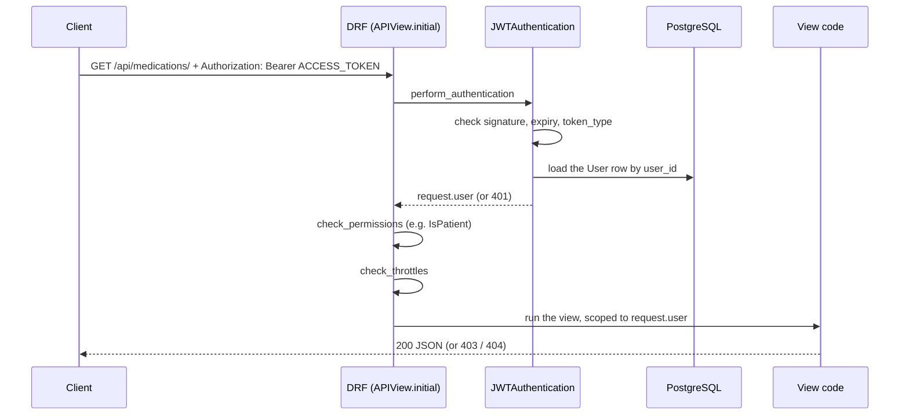
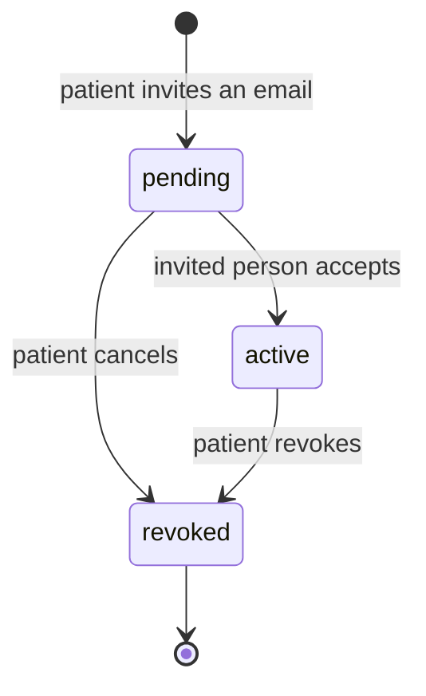

# 04. Authentication, authorisation and access control

## 1. First principles

### Authentication vs authorisation

Two different questions, often confused in interviews:

* **Authentication (AuthN): "Who are you?"** Proving identity: an email and password, or a token.
* **Authorisation (AuthZ): "What are you allowed to do?"** Deciding, for an identified person, whether this
  action on this data is permitted.

Think of a hospital. Showing your ID at the door is authentication. Which wards your badge opens is
authorisation. This project has both, in layers: log in (who), role checks (what kind of user), and *per-record*
checks (is this record yours, or has its owner shared it with you?).

### Passwords are never stored

A password is turned into a **hash** with a one-way function. You cannot compute the password back from the
hash, so a stolen database does not reveal passwords. Django's default hasher is PBKDF2-SHA256, deliberately
slow so guessing is expensive. I checked a stored password in this project:

```text
password stored as: pbkdf2_sha256 | iterations: 1000000 | plaintext present: False
```

### Tokens instead of re-sending the password

Sending your password with every request would be dangerous. Instead you log in once, receive a **token**, and
send the token afterwards. This project uses **JWT** (JSON Web Tokens).

A JWT is three base64 pieces joined by dots: `header.payload.signature`.

* **Header:** the algorithm. I decoded a real one: `{'alg': 'HS256', 'typ': 'JWT'}`.
* **Payload ("claims"):** facts about the token. A real access token from this project has the claims
  `exp` (expires), `iat` (issued at), `jti` (unique token id), `token_type`, `user_id` and our own `role`.
* **Signature:** a keyed hash (HMAC-SHA256) of header and payload, made with the server's secret key. The
  server recomputes it; if anything was altered, the signature no longer matches and the token is rejected.

**A JWT is signed, not encrypted.** Anyone holding it can read the payload (I decoded one without any key).
Never put secrets in it. The signature only guarantees nobody *changed* it. In this project simplejwt signs with
`SECRET_KEY` (I checked: `signing key is SECRET_KEY: True`), which is why `validate_secret_key` in
`config/env.py` refuses a weak key outside debug mode.

### Access and refresh tokens

| Token | Lifetime here | Sent with | Purpose |
|---|---|---|---|
| **Access** | 30 minutes | every API request | Proves who you are. Short-lived because it cannot be revoked |
| **Refresh** | 7 days | only to `/api/auth/refresh/` | Gets a new access token without asking for the password again |

If an access token leaks, it is useful to an attacker for at most 30 minutes. The user does not have to type a
password every 30 minutes because the refresh token quietly renews it.

### HTTP status codes you must know (with the real bodies I got)

| Code | Meaning | Example from this API |
|---|---|---|
| 200 / 201 | OK / created | `GET /api/me/`, `POST /api/auth/register/` |
| 400 | Bad input | `{"timezone": ["Patients must provide an IANA timezone."]}` |
| **401** | Not authenticated (no or bad credentials) | `{"detail": "Authentication credentials were not provided."}` |
| **403** | Authenticated, but not allowed | doctor calling `/api/medications/`: `{"detail": "You do not have permission to perform this action."}` |
| **404** | Not found (also used to hide existence) | doctor asking for an ungranted patient's report: `{"detail": "Not found."}` |
| 409 | Conflict with current state | marking a taken dose as skipped |
| 429 | Too many requests | login throttle: `Request was throttled. Expected available in 60 seconds.` |

## 2. The user model and email login

The project replaces Django's default user with its own (`accounts/models.py`, chapter 03). The manager creates
users with a hashed password and a lowercase email:

*From `accounts/models.py`, `UserManager._create`:*

```python
    def _create(self, email, password, **extra):
        if not email:
            raise ValueError("Users must have an email address.")
        user = self.model(email=self.normalize_email(email).lower(), **extra)
        user.set_password(password)
        user.save(using=self._db)
        return user
```

`user.set_password(password)` hashes the password; the plain value is never saved. `USERNAME_FIELD = "email"`
makes the email the login name.

## 3. Registration: `POST /api/auth/register/`

`RegisterView` (`accounts/views.py`) is open to everyone but throttled:

*From `accounts/views.py`, `RegisterView`:*

```python
class RegisterView(generics.CreateAPIView):
    """Create an account. Patients must supply an IANA timezone."""

    serializer_class = RegisterSerializer
    permission_classes = [permissions.AllowAny]
    authentication_classes: list = []
    throttle_classes = [RegisterThrottle]
```

Two details to be able to explain:

* `permission_classes = [AllowAny]` overrides the global `IsAuthenticated` default (the secure default in
  `config/settings.py`): you cannot be logged in before you have an account.
* `authentication_classes = []` means DRF does not even try to read an `Authorization` header here. I verified
  that registering while sending a **garbage** bearer token still succeeds with `201`, instead of failing with
  401 because of the bad header.

The validation happens in `RegisterSerializer` (`accounts/serializers.py`), step by step:

*From `accounts/serializers.py`, `RegisterSerializer`:*

```python
    def validate_email(self, value):
        value = value.lower()
        if User.objects.filter(email__iexact=value).exists():
            raise serializers.ValidationError("A user with this email already exists.")
        return value

    def validate_password(self, value):
        validate_password(value)
        return value

    def validate(self, attrs):
        if attrs.get("role", Role.PATIENT) == Role.PATIENT and not attrs.get("timezone"):
            raise serializers.ValidationError(
                {"timezone": "Patients must provide an IANA timezone."}
            )
        return attrs
```

1. `validate_email` lowercases the email and refuses a duplicate (case-insensitive).
2. `validate_password` calls Django's `validate_password` (the imported function; the method has the same name)
   which runs the four configured validators: not too similar to the user's details, minimum length, not a
   common password, not all digits.
3. `validate` is the object-level rule: a patient **must** supply a timezone. The timezone field itself already
   has `validate_iana_timezone`, so `IST` is rejected.

Then `create` builds the account and the profile together, or neither:

*From `accounts/serializers.py`, `RegisterSerializer.create`:*

```python
    @transaction.atomic
    def create(self, validated_data):
        timezone = validated_data.pop("timezone", None)
        phone = validated_data.pop("phone_number", "")
        user = User.objects.create_user(**validated_data)
        if user.role == Role.PATIENT:
            PatientProfile.objects.create(user=user, timezone=timezone, phone_number=phone)
        return user
```

`@transaction.atomic` matters: if creating the profile failed, the user row would be rolled back too, so there
is no patient without a profile. Real results:

```text
register -> 201 {"id": 55, "email": "learner@example.com", "full_name": "Learner", "role": "patient",
                 "patient_profile": {"timezone": "Asia/Kolkata", "phone_number": "", "notification_preferences": {...}}}
register patient without timezone -> 400 {"timezone": ["Patients must provide an IANA timezone."]}
register with timezone 'IST' -> 400 {"timezone": ["'IST' is not a valid IANA timezone (e.g. Asia/Kolkata)."]}
```

Note the email was submitted as `Learner@Example.com` and came back as `learner@example.com`. Also note
`role` is chosen by the client at registration. That is a documented limitation (README): anyone can register
as a caregiver or doctor, but that role alone grants access to **nothing**; data access always needs a
patient's grant (section 8).

## 4. Login: `POST /api/auth/login/`

*From `accounts/views.py`, `LoginView`, and `accounts/serializers.py`, `EmailTokenObtainPairSerializer`:*

```python
class LoginView(TokenObtainPairView):
    """Exchange email + password for JWT access and refresh tokens."""

    serializer_class = EmailTokenObtainPairSerializer
    # Per address and per account (see config/ratelimit.py); over the limit gives 429.
    throttle_classes = [LoginIPThrottle, LoginAccountThrottle]
```

```python
class EmailTokenObtainPairSerializer(TokenObtainPairSerializer):
    """Login with email + password; adds the role to the token claims."""

    @classmethod
    def get_token(cls, user):
        token = super().get_token(user)
        token["role"] = user.role
        return token
```

`TokenObtainPairView` is simplejwt's login view. Because our `USERNAME_FIELD` is `email`, the login body is
`{"email": ..., "password": ...}`. We subclass the serializer only to add the `role` claim, which is
convenient for a frontend that wants to know which screens to show. **The server does not trust that claim
for permissions** (see section 6).

Real results:

```text
login wrong password -> 401 {"detail": "No active account found with the given credentials"}
login ok -> 200 keys: ['access', 'refresh']
```

The wrong-password message is deliberately the same whether the email exists or not, so it cannot be used to
discover accounts.

## 5. Refresh: `POST /api/auth/refresh/`

`TokenRefreshView` (from simplejwt, wired in `accounts/urls.py`) takes a refresh token and returns a new access
token. What I observed:

```text
refresh -> 200 keys: ['access']
refresh with an ACCESS token -> 401 {"detail": "Token has wrong type", "code": "token_not_valid"}
```

* It returns **only** `access`: this project does not rotate refresh tokens
  (`ROTATE_REFRESH_TOKENS False`).
* It refuses an access token in place of a refresh token (the `token_type` claim is checked).
* The blacklist app is not installed (`token_blacklist installed: False`), so there is no server-side logout.
  A stolen refresh token works until it expires (7 days). This is listed in the README under "Known
  limitations" and it is the first thing to harden.

## 6. How every request is authenticated

The global default is JWT:

*From `config/settings.py`, `REST_FRAMEWORK` (excerpt):*

```python
    "DEFAULT_AUTHENTICATION_CLASSES": [
        "rest_framework_simplejwt.authentication.JWTAuthentication",
    ],
    "DEFAULT_PERMISSION_CLASSES": ["rest_framework.permissions.IsAuthenticated"],
```

For each request DRF runs `initial()` in this order (I read DRF's own source file `rest_framework/views.py`, inside the installed package): **authentication, then
permissions, then throttles**.



The important line is "load the User row by user_id": **the user is read from the database on every
request.** I proved what that means with the *same token* in three states:

```text
before role change GET /api/medications/ -> 200
after role changed to doctor in DB (same token) -> 403 (role comes from the DB row, not the token claim)
after account deactivated (same token) -> 401 {"detail": "User is inactive", "code": "user_inactive"}
```

So the `role` claim inside the token is only information for the frontend. Authorisation uses
`request.user.role` from the database, which means a role change or a deactivation takes effect
immediately even for tokens already issued. Other failure cases:

```text
GET /api/medications/ without token -> 401 {"detail": "Authentication credentials were not provided."}
garbage bearer -> 401 {"detail": "Given token not valid for any token type", ...}
```

## 7. Roles and permission classes

A **permission class** is a small object with a `has_permission(request, view)` method returning True or
False. If it returns False, DRF answers 403 (or 401 if the request was not authenticated). Ours are in
`accounts/permissions.py`:

*From `accounts/permissions.py`:*

```python
class HasRole(BasePermission):
    """Base class: the request user must be authenticated with ``role``."""

    role: str = ""

    def has_permission(self, request, view):
        user = request.user
        return bool(user and user.is_authenticated and user.role == self.role)


class IsPatient(HasRole):
    role = Role.PATIENT


class IsCaregiver(HasRole):
    role = Role.CAREGIVER


class IsDoctor(HasRole):
    role = Role.DOCTOR
```

`IsGrantee` in the same file allows caregivers **and** doctors, the two roles that can be granted access.

Which view uses which class (from `grep permission_classes`):

| Endpoint (view) | Permission | Meaning |
|---|---|---|
| `POST /api/auth/register/` (`RegisterView`) | `AllowAny` | Anyone |
| `POST /api/auth/login/`, `/refresh/` | none (simplejwt's `TokenViewBase` sets `permission_classes = ()` and `authentication_classes = ()`) | You cannot be logged in before you get a token |
| `GET/PATCH /api/me/` (`MeView`) | `IsAuthenticated` | Any logged-in user |
| `/api/medications/...` (`MedicationViewSet`) | `IsPatient` | Patients only |
| `/api/medications/<id>/schedules/...` (`ScheduleViewSet`) | `IsPatient` | Patients only |
| `/api/doses/...` (`DoseViewSet`) | `IsPatient` | Patients only |
| `/api/access/grants/...` (`GrantListCreateView`, `GrantRevokeView`) | `IsPatient` | Patients manage their own grants |
| `/api/access/invitations/...`, `/api/patients/` | `IsGrantee` | Caregivers and doctors |
| `GET /api/reports/adherence/` (`AdherenceReportView`) | `IsAuthenticated` | Then `resolve_patient` decides (section 8) |
| `GET /api/audit-log/` (`AuditLogListView`) | `IsPatient` | A patient reads who viewed their data |

## 8. Per-record access: making "someone else's data" invisible

Role checks say *what kind* of user you are. They do not say *which records* you may touch. A patient must
not read **another patient's** medications. The project solves this by **scoping the queryset** to the logged-in
user, so other people's rows simply do not exist from your point of view:

*From `medications/views.py`, `MedicationViewSet`:*

```python
    def get_queryset(self):
        if getattr(self, "swagger_fake_view", False):
            return Medication.objects.none()
        qs = Medication.objects.filter(patient=self.request.user)
        active = self.request.query_params.get("active")
        if active is not None:
            qs = qs.filter(is_active=active.lower() == "true")
        return qs
```

`Medication.objects.filter(patient=self.request.user)` is the line that protects the data. Fetching someone
else's medication id gives **404**, not 403, because it is not in your queryset; the same pattern is used for
schedules (`ScheduleViewSet.get_medication`) and doses (`DoseViewSet.get_queryset`). (`swagger_fake_view` is a
guard so the documentation generator can inspect the view without a real user.)

**Why 404 and not 403?** A 403 would say "that exists, but you can't have it", which lets an attacker probe ids.
404 reveals nothing. This is a deliberate API-wide policy (see `accounts/access.py` docstring).

The two checks together explain a pair of results that interviewers love:

```text
doctor GET /api/medications/                   -> 403   (role check: only patients may use this endpoint)
doctor GET report for an ungranted patient     -> 404   (record check: no grant, so the patient is invisible)
doctor GET report without the patient id       -> 400 {"patient": "This field is required."}
```

## 9. Consent: access grants (invite, accept, revoke)

A caregiver or doctor may see a patient's report only through an **active `AccessGrant`**. The lifecycle:



### Invite: existence-blind

*From `accounts/grants.py`, `invite`:*

```python
def invite(patient, email: str) -> None:
    """Record an invitation for ``email``. Idempotent and existence-blind.

    The same code path runs whether or not an account with that email
    exists, and a duplicate of a pending/active invitation is silently
    absorbed by the partial unique constraint (so two simultaneous invites
    cannot create two grants). The caller returns one fixed response.
    """
    try:
        with transaction.atomic():
            AccessGrant.objects.create(patient=patient, invited_email=email.strip().lower())
    except IntegrityError:
        pass  # an open grant for this email already exists: nothing to do
```

The view (`GrantListCreateView.post`) answers `202 Accepted` with one fixed sentence ("Invitation recorded.
Access starts only if that person accepts it ...") for every valid email, existing account or not. So an
attacker cannot use the invite form to find out which emails are registered. The invite endpoint is also
rate-limited per patient (`InviteThrottle`, 20 per hour by default).

### Accept: only the matching email, with a lock

*From `accounts/grants.py`, `accept`:*

```python
    with transaction.atomic():
        grant = (
            AccessGrant.objects.select_for_update(of=("self",))
            .select_related("patient")
            .filter(pk=grant_id, invited_email=grantee.email.lower())
            .first()
        )
        if grant is None or grant.status == GrantStatus.REVOKED:
            raise NotFound()
        if grant.status == GrantStatus.PENDING:
            grant.status = GrantStatus.ACTIVE
            grant.grantee = grantee
            grant.accepted_at = timezone.now()
            grant.save(update_fields=["status", "grantee", "accepted_at"])
        return grant
```

* The lookup includes `invited_email=grantee.email.lower()`: a caregiver can only accept an invitation that
  was addressed to *their* email.
* `select_for_update` locks the row so an accept racing a revoke ends in one consistent state: whichever commits
  first wins.
* A revoked grant cannot be accepted (the patient must invite again), and accepting twice is a harmless no-op.
* The view is `IsGrantee`, so a *patient* account holding the invited email cannot accept
  (`test_a_patient_account_cannot_accept_even_with_the_invited_email`).

### Check on every read: `resolve_patient`

*From `accounts/access.py`:*

```python
def _active_grants():
    return AccessGrant.objects.filter(
        status=GrantStatus.ACTIVE, grantee__isnull=False, grantee__role__in=GRANTEE_ROLES,
        grantee__is_active=True,
    )


def accessible_patients(grantee):
    """Patients who currently have an ACTIVE grant to ``grantee``."""
    return User.objects.filter(
        role=Role.PATIENT,
        pk__in=_active_grants().filter(grantee=grantee).values("patient_id"),
    )
```

```python
    if viewer.role == Role.PATIENT:
        if raw_patient_id in (None, "") or str(raw_patient_id) == str(viewer.pk):
            return viewer
        raise NotFound()
```

`resolve_patient(viewer, raw_patient_id)` (the full function is in `accounts/access.py`) decides whose data a
report request is about:

* A **patient** may only ask about themselves (no id, or their own id); any other id is `NotFound`.
* A **caregiver or doctor** must name a patient (`400` if missing, `400` if not a whole number) and must hold an
  active grant, otherwise `NotFound`.

The docstring at the top of `accounts/access.py` states the principle: every check is a **live database
query**. Nothing is cached in memory, in the JWT or in the session, so **revoking takes effect on the very next
request**.

### The report view and the audit log

*From `reports/views.py`, `AdherenceReportView.get`:*

```python
        patient = resolve_patient(request.user, request.query_params.get("patient"))  # 404 / 400
        now = timezone.now()
        rng = parse_query_range(request.query_params, patient_timezone(patient), now)  # 400
        if request.user.pk != patient.pk:
            audit.record_view(request.user, patient, rng)
        return Response(AdherenceReportSerializer(adherence_report(patient, rng, now)).data)
```

When someone other than the patient views the report, `audit.record_view` writes an `AuditLog` row **before**
any data is returned; if writing fails, the request fails, so data is never returned unaudited. The patient can
read these rows at `GET /api/audit-log/`.

The whole consent journey, run for real:

```text
patient invites doctor    -> 202 {"detail": "Invitation recorded. Access starts only if that person accepts ...
doctor tries report now   -> 404 (no grant yet)
doctor accepts            -> active
doctor views report       -> 200
audit rows written        -> 1 | viewer_email: d6@example.com
patient revokes           -> revoked
doctor report again       -> 404 {"detail": "Not found."}
```

## 10. Rate limiting (brute-force protection)

DRF **throttles** count requests per key and answer **429** over the limit. They are defined in
`config/ratelimit.py` and configured in `config/settings.py`:

| Throttle | Key | Default limit | Protects |
|---|---|---|---|
| `LoginIPThrottle` | client address | 10/min | Password spraying from one machine |
| `LoginAccountThrottle` | the email being logged into | 5/min | Guessing one account from many addresses |
| `RegisterThrottle` | client address | 20/hour | Mass sign-ups |
| `InviteThrottle` | the patient | 20/hour | Using invites to spam addresses |
| `DoseLinkThrottle` | client address | 30/min | Guessing links |

The per-account key does not store the email, only a hash:

*From `config/ratelimit.py`, `LoginAccountThrottle`:*

```python
    def get_cache_key(self, request, view):
        try:
            email = request.data.get("email")
        except Exception:  # unparseable body: the view will reject it anyway
            return None
        if not isinstance(email, str) or not email.strip():
            return None
        return self.cache_format % {"scope": self.scope, "ident": _digest(email.strip().lower())}
```

Real behaviour (7 wrong-password logins for one account within a minute):

```text
[401, 401, 401, 401, 401, 429, 429] | {"detail": "Request was throttled. Expected available in 60 seconds."} | Retry-After header: 60
```

Design choices to mention: counters live in Redis (shared across web processes); the throttles **fail open** (a
Redis outage does not block logins, `ConfiguredThrottle.allow_request` catches `RedisError`); counting is
approximate under heavy concurrency; the per-account limit can be abused to annoy a specific user (README lists
this honestly).

## 11. Other security measures worth naming

* **Bearer header, not cookies.** The API reads the token from the `Authorization` header, so browsers do not
  attach credentials automatically. That removes CSRF risk for the API, and `CORS_ALLOW_CREDENTIALS` stays
  false.
* **Secure default.** `DEFAULT_PERMISSION_CLASSES = IsAuthenticated`: forgetting a permission makes an endpoint
  stricter, not open.
* **The one public, non-JWT door: the dose link.** `scheduling/links.py` signs `{"dose": id, "patient": id}`
  with `django.core.signing` (SECRET_KEY + a salt + timestamp), expires after 24 hours, and the view is
  `@csrf_exempt` because the signed token is the credential and no cookie is involved. `GET` never changes
  data.
* **Secret key validation.** Outside debug mode, a default, placeholder or short `DJANGO_SECRET_KEY` is
  refused at startup (`validate_secret_key`), because JWTs and links are signed with it.
* **Known limitations** (README): no email verification, no password reset, refresh tokens not rotated or
  blacklisted, caregiver/doctor identities not verified.

## Interview questions on this chapter

1. **Q: Authentication vs authorisation?**
   **A:** Authentication proves who you are (email and password, then a token). Authorisation decides what you
   may do. Here: JWT authenticates; role permission classes decide which endpoints you can use; queryset
   scoping and access grants decide which records you can see.

2. **Q: What is a JWT? Is it encrypted?**
   **A:** Three base64 parts: header, payload (claims) and signature. It is signed, not encrypted: anyone can
   read the payload, but nobody can change it without the secret key, because the signature would not match.
   So never put secrets in it.

3. **Q: Why two tokens, access and refresh?**
   **A:** Tokens cannot be revoked once issued. A short-lived access token (30 minutes) limits the damage if
   it leaks, while a longer-lived refresh token (7 days) renews it so the user is not logging in constantly.
   The refresh token is only ever sent to the refresh endpoint.

4. **Q: Where do you check the user's role: in the token or in the database?**
   **A:** In the database. The role claim in the token is only a convenience for the frontend. JWTAuthentication
   loads the user row on every request and permission classes read `request.user.role`. I tested it: changing a
   role in the database made the same token get 403, and deactivating the user made it get 401.

5. **Q: A doctor calls `/api/medications/` and gets 403, but asks for an ungranted patient's report and gets
   404. Why?**
   **A:** Different layers. The medications endpoint uses `IsPatient`, a role check, so a doctor is forbidden.
   The report endpoint allows doctors, then `resolve_patient` looks for an active grant; without one the patient
   is treated as nonexistent (404) so the API doesn't reveal which patient ids exist.

6. **Q: How does revoking access take effect immediately?**
   **A:** Access is never cached or put in the token. `resolve_patient` runs a live query for an active grant on
   every request, so once the grant status becomes `revoked` the next request fails with 404.

7. **Q: How do you stop the invite endpoint from revealing registered emails?**
   **A:** The invitation is addressed to an email, not a user. The same code path runs whether or not an account
   exists, a duplicate is absorbed by a partial unique constraint, and the response is one fixed message with
   status 202. The pending list also doesn't show a grantee until acceptance.

8. **Q: How do you protect against password guessing?**
   **A:** Password hashing (PBKDF2), password validators at registration, and two throttles on login: 10 per
   minute per client address and 5 per minute per account (keyed by a hash of the email). Over the limit the
   API answers 429 with `Retry-After`.

9. **Q: What are the weaknesses of your authentication?**
   **A:** No email verification or password reset, no refresh-token rotation or blacklist (so a stolen refresh
   token works up to 7 days and there is no server-side logout), and roles caregiver/doctor are self-declared
   though they grant nothing without a patient's invitation. I would add rotation with blacklisting, password
   reset and email verification.

10. **Q: Why is `RegisterView.authentication_classes` an empty list?**
    **A:** Registration must work for people with no account, so DRF should not try to authenticate them. With
    an empty list, even a stale or invalid `Authorization` header cannot turn a valid registration into a 401;
    I verified a request with a garbage bearer token still returns 201.

## Common mistakes to avoid

* **Saying "JWT is encrypted".** It is signed. The payload is readable.
* **Trusting the role claim for authorisation.** Always check the database-backed user; this project does.
* **Mixing up 401 and 403.** 401: not authenticated (who are you?). 403: authenticated but not allowed.
* **Returning 403 for "not yours".** That leaks existence; return 404 for resources that are not in the
  caller's scope.
* **Believing role checks alone protect records.** A role says "you are a patient", not "this is your row". The
  scoped queryset (`filter(patient=request.user)`) is what protects the row.
* **Forgetting that long-lived refresh tokens are a risk** when there is no rotation or blacklist.
* **Claiming "the login form can't reveal accounts"** and then returning different errors for "unknown email"
  and "wrong password". This API returns the same message for both.
* **Putting the access decision in the frontend.** The UI hides screens, but only the backend enforces access.
