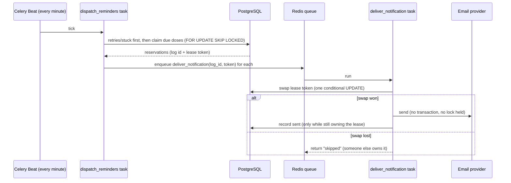
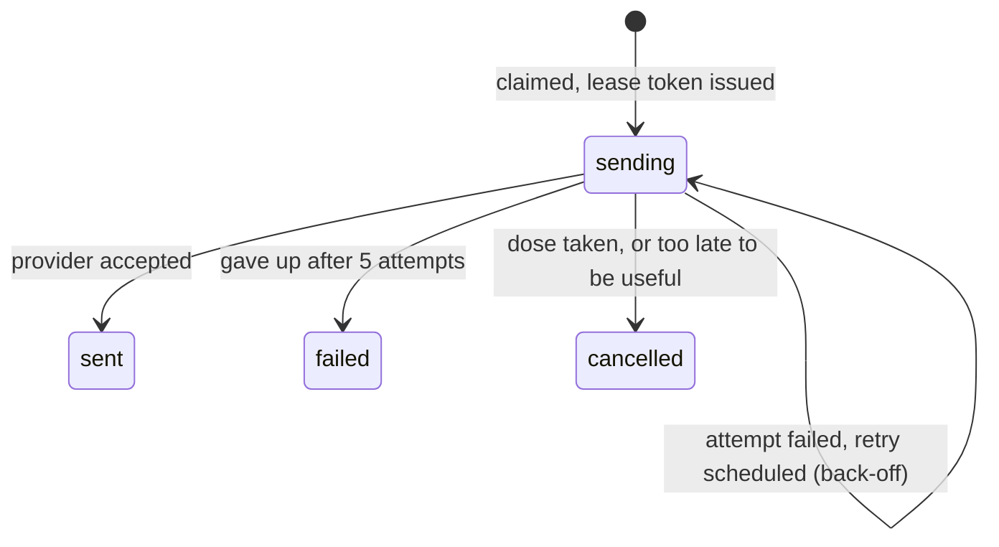
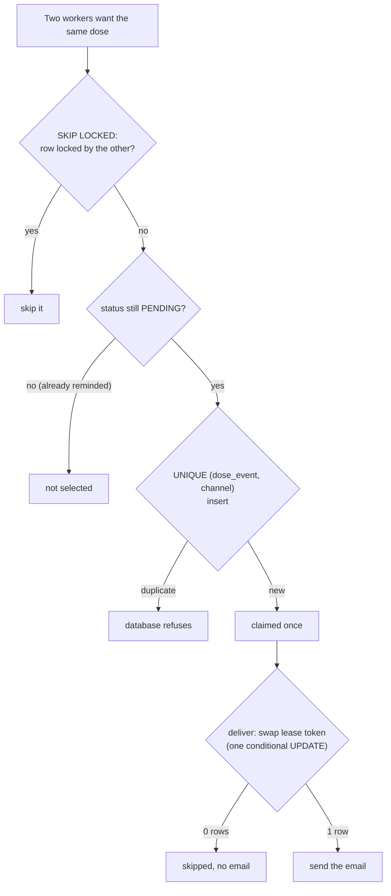

# 07. The reminder pipeline: claim, send, recover

This is the deepest chapter and the one that makes the project interesting. The rule from `CLAUDE.md` is:

> *A reminder must never be sent twice and must never be missed. Use database constraints, row locking and
> idempotent tasks to guarantee this.*

We will see exactly what that sentence can and cannot promise, and how the code delivers it. Everything is in
`notifications/` (mainly `notifications/services.py`), with the dose table from chapter 03.

## 1. First principles

### Why "exactly once" is impossible, and what we do instead

Imagine sending a letter. You hand it to the post office and walk away. If the post office confirms receipt but
your phone dies before you write "sent" in your notebook, your notebook says "not sent" even though it was. If
you trust the notebook and send again, the person gets two letters. If you do not send again, you risk a lost
letter in the opposite case. **You cannot make "send the letter" and "write it in the notebook" one atomic
action**, because the post office is a different system from your notebook.

Our case is identical: the *email provider* is the post office, our *database* is the notebook. So every
reliable messaging system chooses one of three guarantees:

| Guarantee | Meaning | Failure mode |
|---|---|---|
| **At-most-once** | Never send twice | A crash can lose the reminder silently |
| **At-least-once** | Never lose one | In rare crashes a reminder can arrive twice |
| **Exactly-once** | Once, always | Not achievable across two independent systems without extra help from the receiver |

For *medication*, a lost reminder is worse than a rare duplicate. The project chooses **at-least-once**, and
then removes every cause of duplicates except one tiny window that cannot be removed. That window is documented
in the code (section 9).

### The tools used

* **Transaction:** a group of database changes that succeed or fail together.
* **Row lock (`SELECT ... FOR UPDATE`):** "I am working on these rows; others must wait or skip them" until my
  transaction ends.
* **`SKIP LOCKED`:** a PostgreSQL option: when a row is locked by someone else, **skip it instead of waiting**.
  Perfect for work queues: each worker takes different rows.
* **Unique constraint:** the database refuses two rows with the same key (chapter 03).
* **Lease:** a temporary permission with an expiry time: "worker X may send this until 12:10". If X dies, the
  permission expires and someone else can take over.
* **Token:** a one-time secret that proves *which* holder owns the lease. Here `lease_token` (a UUID).
* **Idempotent:** doing it twice equals doing it once.
* **Exponential back-off:** wait longer after each failure (1 minute, 2, 4, 8...) instead of hammering a broken
  provider.
* **Grace window:** how late a reminder may still be useful.

## 2. The design in one picture

Two phases, deliberately separated:

1. **Claim (database only, short transaction).** Decide *which* doses need a reminder and record the claim.
2. **Send (network, no database lock held).** Actually email, then record the outcome.
3. **Recover (a safety net).** Retry failures, and take over from workers that died.



The `NotificationLog` life cycle (chapter 03) in this context:



## 3. The knobs (all in `config/settings.py`, read through `notifications/conf.py`)

| Setting | Default | Meaning |
|---|---|---|
| `REMINDER_LEAD_SECONDS` | 60 | Send this early: doses due within the next minute are claimed |
| `REMINDER_GRACE_MINUTES` | 60 | Still remind up to this late |
| `REMINDER_SENDING_TIMEOUT_SECONDS` | 600 | The lease length: how long a worker owns a send |
| `REMINDER_MAX_ATTEMPTS` | 5 | Give up after this many failed attempts |
| `REMINDER_RETRY_BASE_SECONDS` | 60 | First back-off delay |
| `REMINDER_BATCH_SIZE` | 200 | At most this many doses per claim |
| `DOSE_MISSED_AFTER_MINUTES` | 120 | A dose untouched this long becomes `missed` |

`conf.py` reads the setting **on every call** (so tests can override them). Two relationships are enforced at
startup, because getting them wrong would break the guarantees:

*From `config/settings.py`:*

```python
# A send task is hard-killed after EMAIL_TIMEOUT + 30s; the "sending" lease
# must comfortably outlive that, or recovery could resend a live send.
if REMINDER_SENDING_TIMEOUT_SECONDS < 2 * (EMAIL_TIMEOUT + 30):
    raise ImproperlyConfigured(
        "REMINDER_SENDING_TIMEOUT_SECONDS must be at least 2 x (EMAIL_TIMEOUT + 30)."
    )
# A dose must stop being remindable before it can be marked missed.
if REMINDER_GRACE_MINUTES >= DOSE_MISSED_AFTER_MINUTES:
    raise ImproperlyConfigured(
        "REMINDER_GRACE_MINUTES must be smaller than DOSE_MISSED_AFTER_MINUTES."
    )
```

* **Lease vs time limit.** A send is hard-killed after `EMAIL_TIMEOUT + 30` seconds, so a live send always ends
  before its lease expires; recovery therefore never resends a send that is still running.
* **Grace vs missed.** A dose must stop being remindable (60 min) before it can be marked missed (120 min), so
  we never remind about a dose we have already given up on.

## 4. Step 0: the Beat tick

*From `notifications/tasks.py`, `dispatch_reminders`:*

```python
@shared_task(ignore_result=True)
def dispatch_reminders() -> int:
    """Every minute: claim due doses and pick up retries / stuck sends.

    Claims are committed before tasks are queued. If queuing fails (e.g. the
    broker is down), the rows' leases expire and the next tick recovers them.
    """
    started = time.monotonic()
    reservations = services.dispatch()
    for reservation in reservations:
        deliver_notification.delay(reservation.log_id, str(reservation.token))
    if reservations:  # quiet minutes stay quiet
        log_event(logger, "reminder.dispatch", reservations=len(reservations),
                  duration_ms=round((time.monotonic() - started) * 1000))
```

`services.dispatch()` is "one Beat tick: retries and recoveries first, then newly due doses":
`reserve_retries_and_stuck(now=now) + claim_due_doses(now=now)`. For each **reservation** (a log id plus the
token that proves the lease) a separate `deliver_notification` task is queued.

Notice the order: **claims are committed before tasks are queued.** If the broker is down at that moment, the
claim exists but no task was queued. That is fine: the lease expires after 10 minutes and recovery re-issues it
(section 8). The system is built so that *every* crash point leaves a recoverable state.

## 5. Step 1: claim due doses

The goal: pick the doses that need a reminder *right now*, mark them, and create a log row, **atomically**, with
no two workers picking the same dose.

*From `notifications/services.py`, `claim_due_doses` (the selection):*

```python
    with transaction.atomic():
        doses = list(
            DoseEvent.objects.select_for_update(skip_locked=True, of=("self",))
            .filter(
                status=DoseStatus.PENDING,
                scheduled_at__gte=now - conf.grace(),
                scheduled_at__lte=now + conf.lead(),
                medication__is_active=True,
            )
            .filter(_wants_any_channel(channels))
            .select_related("patient__patient_profile")
            .order_by("scheduled_at")[: conf.batch_size()]
        )
```

Read it clause by clause:

* `select_for_update(skip_locked=True, of=("self",))`: lock the selected **dose rows** (`of=("self",)` locks
  only the dose table's rows, not the joined patient/profile rows) and **skip any row another worker has already
  locked**.
* `status=PENDING`: only doses nobody has handled.
* `scheduled_at__gte=now - grace` and `__lte=now + lead`: the **claim window** `[now - 60 min, now + 60 s]`.
* `medication__is_active=True`: a stopped medication gets no reminders.
* `_wants_any_channel(channels)`: only patients who have at least one enabled channel switched on (a missing
  preference counts as the default: email on, SMS and WhatsApp off).
* `order_by("scheduled_at")[: batch_size]`: oldest first, at most 200 per tick.

The window, verified with a fixed clock (`now` = 12:00):

```text
dose in 90 s (too early)           claimed=0  dose status after: pending
dose in 30 s (inside lead)         claimed=1  dose status after: reminded
dose now                           claimed=1  dose status after: reminded
dose 59 min ago (inside grace)     claimed=1  dose status after: reminded
dose 61 min ago (past grace)       claimed=0  dose status after: pending
```

The **late-dose grace window** is the 60-minute lookback. If the workers were down for 20 minutes and come
back, doses 20 minutes late are still reminded. A dose 61 minutes late is **not** reminded (too late to be
useful) and stays `pending` until the missed job (section 10) marks it `missed`. That is the one thing the
guarantee explicitly does *not* cover (section 9).

Then, still inside the same transaction, each claimed dose is flipped and logged:

*From `notifications/services.py`, `claim_due_doses` (the claim):*

```python
        existing = set(
            NotificationLog.objects.filter(dose_event__in=doses)
            .values_list("dose_event_id", "channel")
        )
        reminded, logs = [], []
        for dose in doses:
            wanted = patient_channels(dose.patient, channels)
            if not wanted:
                continue
            reminded.append(dose.pk)
            logs += [
                NotificationLog(
                    dose_event=dose, channel=channel, status=NotificationStatus.SENDING,
                    lease_token=uuid.uuid4(), lease_until=now + conf.sending_timeout(),
                    next_attempt_at=now,
                )
                for channel in wanted
                if (dose.pk, channel) not in existing
            ]
        DoseEvent.objects.filter(pk__in=reminded).update(status=DoseStatus.REMINDED)
        NotificationLog.objects.bulk_create(logs)
```

For every claimed dose and each of the patient's channels:

1. A `NotificationLog` row is created with status `sending`, a fresh random **`lease_token`**
   (`uuid.uuid4()`), and `lease_until = now + 10 minutes`. This *is* the claim.
2. The dose becomes `reminded` **in the same transaction** that inserts the log. Either both happen or neither.
3. The unique constraint `(dose_event, channel)` guarantees a dose can have only one log row per channel, ever.
   (The `existing` check is a "pure safety net", as its comment says: such rows could only exist if someone reset
   a dose to pending by hand.)

After the transaction commits, `reminder.claimed` is logged for each claim, so logs only report claims that
really exist. The function returns `Reservation(log_id, token)` objects.

### Why `SKIP LOCKED` instead of waiting?

Two workers (or two overlapping Beat ticks) run `claim_due_doses` at about the same time. With a plain
`FOR UPDATE` the second one would **wait** for the first to finish, then see the dose is no longer `pending`
and take nothing: correct but slow, and it would pile up waiting workers. With `SKIP LOCKED` the second one
**skips the locked rows immediately** and moves on (to other doses, or finishes with nothing). Section 10 shows
real timings.

## 6. Why the send happens outside the transaction

The second phase calls the email provider over the network. Compare two designs:

* **Send inside the claiming transaction.** The row locks would be held for the whole time the SMTP server takes
  to answer (seconds, or up to the 30-second timeout when it is slow). Other workers skip those rows, the
  database connection is tied up, and if the provider hangs the transaction hangs with it. Worse, you could
  *send* and then *roll back* the claim, the worst possible outcome (an email with no record).
* **Claim first, commit, then send.** The transaction holds locks for milliseconds. The long, unreliable part
  (the network) happens with **no lock and no open transaction**, protected by the lease instead.

The code says so explicitly:

*From `notifications/services.py`, `deliver`:*

```python
    started = time.monotonic()
    try:  # No transaction or row lock is held while talking to the provider.
        get_channel(log.channel).send(build_reminder(log))
    except Exception as exc:  # noqa: BLE001 - any failure is a failed attempt
        return _record_failure(log, owned, exc, now)

    sent_at = timezone.now()
    if _finish(log_id, owned, status=NotificationStatus.SENT, sent_at=sent_at, error=""):
        DoseEvent.objects.filter(pk=log.dose_event_id, reminder_sent_at__isnull=True).update(
            reminder_sent_at=sent_at
        )
    else:
        log_event(logger, "reminder.lease_lost_after_send", logging.WARNING, log_id=log_id,
                  dose_id=log.dose_event_id)
```

The price of not holding a lock is that "who may send?" must be answered another way: the **lease token**.

## 7. Step 2: deliver (the lease-token swap)

`deliver_notification(log_id, token)` calls `services.deliver`, whose first act is to **swap the token**:

*From `notifications/services.py`, `_acquire`:*

```python
def _acquire(log_id: int, token, now: datetime) -> uuid.UUID | None:
    """Swap the reserved token for a new one. Exactly one caller can win.

    A single conditional UPDATE: PostgreSQL row locking means a concurrent
    caller with the same token waits, re-checks the WHERE clause, and finds
    the token already changed.
    """
    new_token = uuid.uuid4()
    won = NotificationLog.objects.filter(
        pk=log_id, status=NotificationStatus.SENDING, lease_token=token, lease_until__gt=now,
    ).update(
        lease_token=new_token, lease_until=now + conf.sending_timeout(),
        attempts=F("attempts") + 1, last_attempt_at=now,
    )
    return new_token if won else None
```

This is one SQL statement: *"UPDATE the log row, setting a new token, WHERE the row is still `sending` AND its
token equals the one I was given AND the lease has not expired."* Because it is a single atomic statement:

* The first caller finds the token equal, changes it, and `update` returns **1** (it won).
* Any other caller with the *same old token* either waits for the row lock and then re-checks the `WHERE`
  (the token has changed, so zero rows match), or arrives later and also matches nothing. It gets **0** (lost).
* The winner also increments `attempts` and stamps `last_attempt_at` in the same statement.

A loser returns `"skipped"` and sends nothing. This is what makes the task **idempotent**: a broker that
redelivers the same task (Celery's `acks_late`), a retried task, and a recovery racing the original all collide
on this one conditional update, and exactly one proceeds.

After the swap the worker holds a **new** token (`owned`). Recording the outcome uses it:

*From `notifications/services.py`, `_finish`:*

```python
def _finish(log_id: int, token: uuid.UUID, **fields) -> bool:
    """Record an outcome, but only while we still own the lease."""
    return bool(
        NotificationLog.objects.filter(pk=log_id, lease_token=token)
        .update(lease_token=None, lease_until=None, **fields)
    )
```

`_finish` only writes if `lease_token` still equals the worker's token. If the worker was so slow that the lease
expired and recovery gave the row to someone else (the token was rotated), this returns `False` and the stale
worker records nothing. It logs `reminder.lease_lost_after_send` as a warning (`test_a_send_that_outlives_its_lease_is_reported_and_not_recorded_as_ours`).

### Cancelled instead of sent

Before sending, the worker re-checks that the reminder is still wanted:

*From `notifications/services.py`, `_reason_not_to_send`:*

```python
def _reason_not_to_send(dose: DoseEvent, now: datetime) -> str:
    if dose.status != DoseStatus.REMINDED:
        return f"Dose is {dose.status}; reminder no longer needed."
    if now > dose.scheduled_at + conf.grace():
        return "Too late: past the reminder grace period."
    return ""
```

Verified:

```text
deliver 2 min later (dose was 59 min late when claimed) -> 'cancelled', error='Too late: past the reminder grace period.', emails=0
patient marked it taken before the worker ran -> 'cancelled', error='Dose is taken; reminder no longer needed.', emails=0
```

A cancelled log is a *recorded* outcome (status `cancelled` with the reason), not a silent loss.

The possible results of `deliver`:

| Return | Meaning |
|---|---|
| `"sent"` | Provider accepted; log is `sent` |
| `"retry"` | Failed, a retry is scheduled |
| `"failed"` | Failed and attempts exhausted |
| `"cancelled"` | No longer needed (taken, or too late) |
| `"skipped"` | Someone else owns or finished this row; nothing was sent |

## 8. Retries, back-off and recovery

### Retries with exponential back-off

*From `notifications/conf.py` and `notifications/services.py`:*

```python
def retry_delay(attempts: int) -> timedelta:
    """Exponential backoff after the Nth failed attempt: base, 2x, 4x, 8x ..."""
    return timedelta(seconds=settings.REMINDER_RETRY_BASE_SECONDS * 2 ** (attempts - 1))
```

```python
def _record_failure(log: NotificationLog, owned: uuid.UUID, exc: Exception, now: datetime) -> str:
    """Schedule a retry with exponential backoff, or give up after the maximum."""
    error = f"{type(exc).__name__}: {exc}"[:1000]
    if log.attempts >= conf.max_attempts():
        _finish(log.pk, owned, status=NotificationStatus.FAILED, error=error)
        log_event(logger, "reminder.failed", logging.ERROR, log_id=log.pk, dose_id=log.dose_event_id,
                  channel=log.channel, attempts=log.attempts, error_type=type(exc).__name__)
        return "failed"
    retry_at = now + conf.retry_delay(log.attempts)
    _finish(log.pk, owned, error=error, next_attempt_at=retry_at)
```

Note that a failed attempt does **not** change `status`: the row stays `sending`, with `next_attempt_at` pushed
into the future and the lease cleared. I simulated a provider that always fails, advancing the clock by hand:

```text
attempt 1 at +   0s -> retry   status=sending attempts=1 next retry in   60s  error='ConnectionError: smtp down'
attempt 2 at +  60s -> retry   status=sending attempts=2 next retry in  120s  error='ConnectionError: smtp down'
attempt 3 at + 180s -> retry   status=sending attempts=3 next retry in  240s  error='ConnectionError: smtp down'
attempt 4 at + 420s -> retry   status=sending attempts=4 next retry in  480s  error='ConnectionError: smtp down'
attempt 5 at + 900s -> failed  status=failed  attempts=5 next retry in    0s  error='ConnectionError: smtp down'
emails actually sent: 0
```

Delays double: 60, 120, 240, 480 seconds. After the 5th failure the row becomes `failed`, a **recorded** final
state with the error text, never a silent loss. All five attempts fit inside the 60-minute grace window
(15 minutes in total); if retries ran past it, `_reason_not_to_send` would cancel the reminder as too late
(`test_retry_after_grace_period_is_cancelled`).

### Who runs the retry? `reserve_retries_and_stuck`

*From `notifications/services.py`, `reserve_retries_and_stuck`:*

```python
    now = now or timezone.now()
    with transaction.atomic():
        logs = list(
            NotificationLog.objects.select_for_update(skip_locked=True)
            .filter(status=NotificationStatus.SENDING, next_attempt_at__lte=now)
            .filter(Q(lease_until__isnull=True) | Q(lease_until__lte=now))
            .order_by("next_attempt_at")[: conf.batch_size()]
        )
        stuck = [log for log in logs if log.lease_until is not None]
        for log in logs:
            log.lease_token = uuid.uuid4()
            log.lease_until = now + conf.sending_timeout()
        NotificationLog.objects.bulk_update(logs, ["lease_token", "lease_until"])
```

This runs at the start of every Beat tick and finds `sending` rows that are **due** (`next_attempt_at <= now`)
and **not currently leased** (no lease, or the lease has expired). It covers two situations with one query:

* **A scheduled retry whose back-off has elapsed.** The failed attempt cleared the lease (`lease_until` is
  NULL), so the row qualifies once `next_attempt_at` passes.
* **A stuck send.** A worker claimed (or acquired) the row and then died: the lease was never cleared, so it
  qualifies once `lease_until` passes. Other possible cause: the delivery task was never queued (broker down).
  These are logged as `reminder.recovered` (a warning), unlike plain retries (`reminder.retry_due`).

Both get a **new** lease token. Rotating the token is what makes any old, still-queued task for that row
harmless: when it finally runs, its token no longer matches and `_acquire` returns nothing. Verified:

```text
before the lease expires: 0 recoveries (lease still valid)
after the lease expires : 1 recovery; token rotated: True
late task from the dead worker (old token) -> skipped
recovery's deliver -> sent | emails: 1
```

(`test_worker_dying_mid_send_is_recovered`, `test_stuck_sending_is_recovered_after_timeout_and_sent_once`,
`test_concurrent_recovery_of_a_stuck_send_sends_once`.)

## 9. The exact delivery guarantee and its narrow failure window

The authors wrote the guarantee at the top of the module. Read it carefully; being able to recite it is
interview gold:

*From `notifications/services.py`, module docstring:*

```python
DELIVERY GUARANTEE: AT-LEAST-ONCE per (dose, channel)
=====================================================

Every due dose that is still pending, within the grace period, and whose
patient has the channel switched on, gets its reminder delivered at least
once, or ends in a recorded ``failed``/``cancelled`` NotificationLog. A
reminder is sent a second time in exactly one narrow window:

    the provider (SMTP server) accepted the message, and then the worker
    died (crash, OOM kill, lost database connection) before it committed
    ``status="sent"``.

The log row is then still ``sending`` with a lease. When the lease expires
(REMINDER_SENDING_TIMEOUT_SECONDS, default 10 minutes) recovery sends it
again. We chose this over at-most-once because, for medication, a rare
duplicate reminder is far less harmful than a silently lost one. The resend
carries the same Message-ID header, so many mail systems collapse it.
```

### What can go wrong, and what happens (a crash-point table)

| Where something goes wrong | What the database holds | What happens next | Outcome |
|---|---|---|---|
| Crash **before the claim commits** | Nothing (transaction rolled back) | Next tick claims the still-`pending` dose | Sent once |
| Crash **after the claim, before the task is queued** (broker down) | Log `sending` with a lease | Lease expires; `reserve_retries_and_stuck` re-issues it | Sent once |
| Worker dies **before sending** | Lease swapped, `sending` | Lease expires; recovery re-issues it | Sent once |
| Provider **rejects or times out** | `sending`, error saved, `next_attempt_at` set | Retry with back-off, up to 5 | Sent once, or `failed` (recorded) |
| Broker **redelivers** the same task | Token already swapped | Second caller's `_acquire` loses | **Not** sent twice |
| Two **workers / Beat ticks** race | One lock holder | The other **skips** locked rows | **Not** sent twice |
| Worker dies **after the provider accepted, before recording `sent`** | `sending` with an unexpired lease | Lease expires; recovery **resends** | **Sent twice** (the documented window) |
| Dose handled by patient first | Dose `taken` | `deliver` cancels | Recorded `cancelled` |
| Workers down **longer than the grace** | Dose still `pending` | No reminder; later marked `missed` | **No reminder** (documented exception) |

So the full honest statement is: *at-least-once, with one narrow duplicate window, and one documented
exception (workers down longer than 60 minutes).* The duplicate carries the same `Message-ID`
(`<dose-reminder-{log.pk}@domain>`, from `build_reminder`/`message_id` in `notifications/content.py`), which many
mail systems use to collapse duplicates (`test_email_has_stable_message_id`).

The lease length (10 minutes) is deliberately longer than the send can ever run, so recovery cannot fire on a
send that is still alive. Only a machine frozen for longer than the lease (a paused virtual machine, say) could
produce an overlap, and that is the same window as above.

## 10. A step-by-step timeline of two workers racing for the same dose

I ran this on real PostgreSQL in a scratch database, with real threads, and timestamped each step. One dose is
due now. Worker **A** claims it and keeps its transaction open (so the lock is held); worker **B** tries to claim
while A holds the lock; worker **C** tries once A has committed and also redelivers A's task.

```text
+    0.4 ms  worker A: BEGIN transaction; claim_due_doses() -> SELECT ... FOR UPDATE SKIP LOCKED
+   20.6 ms  worker A: claimed 1 dose (row is locked; dose set to 'reminded', log row inserted, NOT yet committed)
+  221.0 ms  worker B: claim_due_doses() while A still holds the lock ...
+  243.9 ms  worker B: returned 0 claims after 23 ms (it SKIPPED the locked row, it did not wait)
+  444.4 ms  worker A: COMMIT (locks released)
+  448.4 ms  worker C: claim_due_doses() after A committed ...
+  481.0 ms  worker C: returned 0 claims (dose is now 'reminded', no longer 'pending')
+  487.4 ms  worker C: duplicate deliver(SAME token as A) -> 'skipped'  [dose=reminded; logs=[('email', 'sending', 1)]; emails=0]
+  583.8 ms  worker A: deliver(token) -> 'sent'  [dose=reminded; logs=[('email', 'sent', 1)]; emails=1]
FINAL: dose=reminded; logs=[('email', 'sent', 1)]; emails=1
       log.status=sent attempts=1 lease_token=None
```

How to read it, line by line:

1. **+0 to +20 ms, A claims.** A's transaction locks the dose row, flips it to `reminded`, inserts the log
   (`sending`, with a token). Nothing is committed yet, so the lock is held.
2. **+221 ms, B arrives while A holds the lock.** B runs the same query. The locked row is invisible to B
   because of `SKIP LOCKED`.
3. **+244 ms, B returns nothing after 23 ms.** B did *not* wait the roughly 220 ms until A committed. It just finished.
   (This is `test_locked_dose_is_skipped_not_waited_for`.)
4. **+444 ms, A commits.** The claim is now permanent and visible: dose `reminded`, log `sending`.
5. **+448 to +481 ms, C claims.** The dose is no longer `pending`, so the query finds nothing. A second claim is
   impossible by the `status=PENDING` filter *and* by the unique constraint on `(dose_event, channel)`.
6. **+487 ms, C also tries to deliver A's reservation (a duplicate task, same token).** A had already swapped
   the token in `_acquire` (note `attempts` is already 1 and the log is still `sending`, because A is in the
   middle of sending), so C's conditional `UPDATE` matches **0 rows** and returns `'skipped'`. Zero emails sent
   by C.
7. **+584 ms, A finishes sending and records `sent`.** One email in total, `attempts=1`, token cleared.

(In a different run A's and C's deliveries could finish in the other order, because they genuinely race. What
never changes is the result: **exactly one wins the swap, so exactly one email**. The test
`test_same_delivery_task_running_twice_at_once_sends_once` runs four threads on one reservation and asserts
the results are one `sent` and three `skipped`.)

### Three layers, any one of which stops a double send



## 11. The missed-dose job

If nothing happens to a dose for 120 minutes, it becomes `missed`. This is a separate Beat task (every 5
minutes):

*From `notifications/services.py`, `mark_missed_doses`:*

```python
    now = now or timezone.now()
    count = DoseEvent.objects.filter(
        status__in=[DoseStatus.PENDING, DoseStatus.REMINDED],
        scheduled_at__lt=now - conf.missed_after(),
    ).update(status=DoseStatus.MISSED, missed_at=now)
```

One `UPDATE` statement, no Python loop. Two properties matter:

* **It only touches `pending` and `reminded`** rows. A dose already `taken` or `skipped` can never become
  missed.
* **It cannot overwrite a dose being taken at the same moment.** PostgreSQL runs at the READ COMMITTED isolation
  level here (I checked: `isolation level in use: read committed`; the project sets no `OPTIONS` that change
  it). If the `UPDATE` reaches a row locked by someone changing it, it waits for that transaction to finish,
  then **re-evaluates the `WHERE` clause** on the new version of the row. A dose just marked `taken` no longer
  matches `status IN (pending, reminded)`, so it is left alone. The test
  `test_marking_missed_never_overwrites_a_dose_taken_concurrently` makes that real with two threads.

Verified with a fixed clock:

```text
119 min overdue -> marked missed: 0
121 min overdue -> marked missed: 1
status: missed | missed_at set: True
patient marks it taken later -> status=taken taken_late=True missed_at kept=True
job never touches a taken dose: 0
```

A missed dose is not final: the patient can still mark it taken (chapter 08), and then it is flagged
`taken_late` while `missed_at` is kept for the record.

## 12. What gets logged (the operator's view)

Every step writes one structured event with identifiers only (chapter 12 explains why no personal data):

| Event | When | Level |
|---|---|---|
| `reminder.claimed` | After the claim commits (includes `lateness_s`) | INFO |
| `reminder.dispatch` | A Beat tick that did something (summary count) | INFO |
| `reminder.sent` | Provider accepted (`attempt`, `send_ms`, `lateness_s`) | INFO |
| `reminder.skipped` | Lost the lease swap (`reason=lease_not_held`) | INFO |
| `reminder.cancelled` | Dose taken or past grace | INFO |
| `reminder.retry_scheduled` | A failed attempt with back-off (`retry_at`) | WARNING |
| `reminder.retry_due` | A retry whose delay elapsed | INFO |
| `reminder.recovered` | A stuck lease was re-issued | WARNING |
| `reminder.failed` | Gave up after 5 attempts | ERROR |
| `reminder.lease_lost_after_send` | Sent, but the lease had been taken over | WARNING |
| `dose.marked_missed` | The missed job changed rows (`count`) | WARNING |

## 13. Where each rule is tested

| Rule | Test (`notifications/tests/`) |
|---|---|
| Claim window / lead | `test_lead_window`, `test_late_dose_within_grace_is_still_reminded`, `test_dose_beyond_grace_is_not_reminded_and_later_missed` |
| Dispatch twice sends once | `test_running_dispatch_twice_sends_once`, `test_retrying_the_delivery_task_does_not_duplicate` |
| Unique per dose and channel | `test_log_is_unique_per_dose_and_channel` |
| Back-off and give-up | `test_backoff_is_exponential`, `test_failed_send_is_retried_with_backoff_then_succeeds`, `test_gives_up_after_max_attempts_and_records_failure` |
| Recovery | `test_stuck_sending_is_recovered_after_timeout_and_sent_once`, `test_worker_dying_mid_send_is_recovered` |
| Cancel | `test_dose_taken_before_send_is_cancelled`, `test_retry_after_grace_period_is_cancelled` |
| Preferences | `test_patient_with_email_off_is_skipped`, `test_missing_email_preference_defaults_to_on` |
| Real-thread races | `test_two_workers_at_once_send_exactly_one_reminder`, `test_many_workers_many_doses_each_reminded_exactly_once`, `test_locked_dose_is_skipped_not_waited_for`, `test_same_delivery_task_running_twice_at_once_sends_once`, `test_concurrent_recovery_of_a_stuck_send_sends_once` |

## 14. Try it yourself

```bash
pytest notifications/tests -v            # about 20 seconds
pytest notifications/tests/test_concurrency.py -v
```

Break it on purpose and watch the tests fail. I ran each of these changes (and then undid it); the results are
real:

| Change to `notifications/services.py` | Result |
|---|---|
| Remove `skip_locked=True` from the claim query | **1 test fails**: `test_locked_dose_is_skipped_not_waited_for` (worker B now waits for A) |
| Remove `lease_token=token` from the `filter(...)` in `_acquire` | **1 test fails**: `test_same_delivery_task_running_twice_at_once_sends_once`. The other 53 notification tests still pass! |
| Remove the line that sets the claimed doses to `reminded` | **22 tests fail**, across the pipeline, logging, edge-case and concurrency tests |

The middle row is the most instructive. Without the token check, every *sequential* test still passes, because
after the first send the row is no longer `sending`, so a second sequential call matches nothing anyway. Only a
test that runs the same delivery from several real threads at the same instant exposes the missing check. That
is why this project has real-thread concurrency tests (chapter 13).

## Interview questions on this chapter

1. **Q: Can you guarantee exactly-once delivery of a reminder?**
   **A:** No, not across two independent systems (our database and the email provider): a crash between "the
   provider accepted it" and "we recorded it" cannot be made atomic. I chose at-least-once, because a lost
   medication reminder is worse than a rare duplicate, and I removed every duplicate cause except that one
   window, which I documented. A resend even carries the same Message-ID so mail systems can collapse it.

2. **Q: Walk me through how a due dose becomes an email.**
   **A:** Beat enqueues `dispatch_reminders` each minute. It first re-issues leases for due retries and stuck
   sends, then runs `claim_due_doses`: in one short transaction it locks pending doses in the window with
   `FOR UPDATE SKIP LOCKED`, sets them `reminded` and inserts a `sending` log row with a lease token. After
   commit it queues `deliver_notification(log_id, token)`. That task swaps the token with a conditional
   `UPDATE`, sends the email outside any transaction, then records `sent` while still owning the lease.

3. **Q: What does `SKIP LOCKED` do and why use it here?**
   **A:** It makes a locking query skip rows that another transaction has locked instead of waiting. For a work
   queue it means concurrent workers take different rows and never block each other, so overlapping Beat ticks
   or several workers cannot claim the same dose and do not pile up waiting.

4. **Q: What is the lease token for?**
   **A:** Because sending happens outside a transaction, I need another way to decide who may send. The log row
   holds a one-time `lease_token` and `lease_until`. `deliver` does one conditional `UPDATE ... WHERE lease_token
   = <mine> AND lease_until > now` that sets a new token. Only one caller can match, so duplicate or redelivered
   tasks get zero rows and send nothing. Recording the result also requires the current token, so a stale
   worker cannot overwrite a newer owner's outcome.

5. **Q: Why not send the email inside the claiming transaction?**
   **A:** It would hold row locks and a database connection for as long as the network call takes (up to the
   timeout), and a rollback after sending would leave an email with no record. Claim-then-send keeps the
   transaction to milliseconds and puts the unreliable part under a lease.

6. **Q: What happens if the worker crashes after claiming but before sending?**
   **A:** The log row is `sending` with a lease that nobody uses. When the lease expires,
   `reserve_retries_and_stuck` on a later Beat tick finds it, rotates the token and a new delivery task sends
   it. The dead worker's old task, if it ever runs, has a stale token and is skipped. It is logged as
   `reminder.recovered`.

7. **Q: How do retries work?**
   **A:** A failed attempt keeps the row `sending`, saves the error, clears the lease and sets
   `next_attempt_at = now + 60s x 2^(attempts-1)`. Later ticks pick it up when due. After 5 attempts the row
   becomes `failed`, a recorded final state. If a retry would run past the 60-minute grace window it is
   cancelled instead.

8. **Q: What is the grace window and why does it exist?**
   **A:** It is how late a reminder may still be useful (60 minutes). Doses up to that late are claimed, so a
   short outage self-heals. Beyond it a reminder would be pointless or confusing, so the dose stays pending
   until the missed job marks it missed after 120 minutes. The settings refuse a configuration where grace is
   not smaller than the missed threshold.

9. **Q: Under what exact circumstances can the patient get two reminders?**
   **A:** Only if the email provider accepted the message and the worker then died before committing
   `status=sent`. The row stays `sending` with a lease, the lease expires, and recovery resends it. Everything
   else (racing workers, redelivered tasks, retries) is prevented by `SKIP LOCKED`, the status filter, the
   unique `(dose_event, channel)` constraint and the token swap.

10. **Q: How is the missed-dose job safe against a patient tapping Taken at the same moment?**
    **A:** It is a single `UPDATE ... WHERE status IN (pending, reminded)`. Under PostgreSQL's READ COMMITTED
    level, if the row is locked by the transaction marking it taken, the update waits, then re-checks the
    `WHERE` against the new row version. The dose is now `taken`, so it no longer matches and is not
    overwritten. A test with two real threads proves it.

## Common mistakes to avoid

* **Claiming "exactly once".** Say "at-least-once with one documented narrow window".
* **Holding a lock while calling an external service.** That is the exact anti-pattern this design avoids.
* **Treating the unique constraint as the only protection.** It is the last line; `SKIP LOCKED`, the status
  filter and the token swap prevent the conflict from ever happening in normal operation.
* **Describing the lease as a lock.** A lease is a *time-limited claim recorded in the row*; no database lock is
  held while it is out. That is why it needs an expiry, a token and a recovery job.
* **Forgetting why the token is rotated on recovery.** Without rotation, a delayed old task could still send,
  producing a duplicate.
* **Mixing up the grace window and the missed threshold.** Grace (60 min) decides who may still be reminded;
  missed (120 min) decides when a dose is written off. Grace must be smaller.
* **Saying retries happen "immediately".** They use back-off and are picked up by the next Beat ticks, so the
  delay is the back-off plus up to a minute.
* **Assuming failed means lost.** A `failed` or `cancelled` log is a recorded, queryable outcome.
