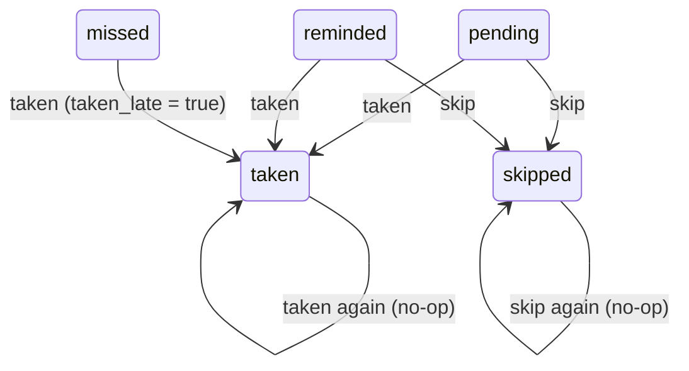

# 08. Dose actions and the one-click email link

A patient can tell the system what happened to a dose in two ways: from the app (`POST /api/doses/<id>/taken/`
or `/skip/`), or by clicking the link in the reminder email. Both paths end in the same two functions, so the
rules are identical. This chapter explains those rules, why they are safe when two requests collide, and why the
email link is built the way it is.

## 1. First principles

### Safe and unsafe HTTP methods

HTTP defines methods with different promises:

| Method | Promise | Used for |
|---|---|---|
| `GET`, `HEAD` | **Safe**: asking must not change anything | Reading pages and data |
| `POST` | **Unsafe**: may change state | Creating things, performing actions |

The promise matters because software that is *not* a person also sends `GET` requests: search crawlers, link
previews in chat apps, and above all **email security scanners**, which open every link in an incoming email to
check it for malware. If opening a link could change data, a scanner would "click" it for you. So the rule is:
**a link in an email must be safe to open.** Anything that changes state needs a `POST`.

### Idempotent operations

An operation is **idempotent** if doing it twice has the same effect as doing it once. Patients double-click,
phones retry on a bad connection, and a person may tap "Taken" in the app and then also click the email link.
Each action must therefore be harmless to repeat.

### State machines

A dose has a status, and only some changes are allowed (`pending` to `taken` is fine, `taken` to `skipped` is
not). Writing the allowed moves down as a table, and rejecting everything else, is called a **state machine**.
It turns "what if the user does something odd?" into a list you can test.

### Signed tokens

The email link has to identify one dose and prove it came from us, without making the patient log in. A
**signed token** does that: the server writes some data, adds a **signature** made with a secret key (an HMAC),
and later recomputes the signature. If anyone edits the data, the signature no longer matches. The data is
**readable** (signed, not encrypted), and the token can carry a timestamp so it **expires**.

## 2. The rules

Written at the top of `scheduling/dose_actions.py`:

| Action | Allowed from | Result | Repeating it |
|---|---|---|---|
| **taken** | `pending`, `reminded`, `missed` | `taken`, `taken_at` set; if it was `missed`, `taken_late = true` and `missed_at` is kept | No-op, returns the same dose |
| **skipped** | `pending`, `reminded` | `skipped` | No-op, returns the same dose |
| anything else | | **409 Conflict** | |

A `taken` dose is **final**: it cannot become `skipped`, and the missed job only touches `pending`/`reminded`
rows (chapter 07). A `skipped` dose cannot be marked taken either. I called the real API:

```text
taken (pending)                    -> 200 {"status": "taken", "taken_late": false}
taken again (repeat)               -> 200 {"status": "taken", "taken_late": false}   (same taken_at as the first time)
skip a TAKEN dose                  -> 409 {"detail": "A taken dose cannot be marked skipped."}
skip (pending)                     -> 200 {"status": "skipped", "taken_late": false}
skip again (repeat)                -> 200 {"status": "skipped", "taken_late": false}
taken after SKIPPED                -> 409 {"detail": "A skipped dose cannot be marked taken."}
skip a MISSED dose                 -> 409 {"detail": "A missed dose cannot be marked skipped."}
taken a MISSED dose (late)         -> 200 {"status": "taken", "taken_late": true}
```



## 3. The code: `scheduling/dose_actions.py`

*From `scheduling/dose_actions.py`:*

```python
TAKEABLE = {DoseStatus.PENDING, DoseStatus.REMINDED, DoseStatus.MISSED}
SKIPPABLE = {DoseStatus.PENDING, DoseStatus.REMINDED}


class DoseConflict(Exception):
    """The dose's current status does not allow the requested action."""


def _lock(dose_id: int, patient_id: int) -> DoseEvent:
    """Lock the dose, scoped to its patient. Raises DoseEvent.DoesNotExist."""
    return (
        DoseEvent.objects.select_for_update(of=("self",))
        .select_related("medication")
        .get(pk=dose_id, patient_id=patient_id)
    )
```

The two sets *are* the state machine. `_lock` fetches the dose with `SELECT ... FOR UPDATE` and, importantly,
filters by `patient_id` too, so a dose id that belongs to someone else simply does not exist for this caller.

*From `scheduling/dose_actions.py`, `mark_taken`:*

```python
def mark_taken(dose_id: int, patient_id: int, *, now: datetime | None = None):
    """Mark a dose taken. Returns ``(dose, changed)``; ``changed`` is False on a repeat."""
    now = now or timezone.now()
    with transaction.atomic():
        dose = _lock(dose_id, patient_id)
        if dose.status == DoseStatus.TAKEN:
            return dose, False
        if dose.status not in TAKEABLE:
            raise DoseConflict(f"A {dose.status} dose cannot be marked taken.")
        dose.taken_late = dose.status == DoseStatus.MISSED
        dose.status = DoseStatus.TAKEN
        dose.taken_at = now
        dose.save(update_fields=["status", "taken_at", "taken_late"])
        return dose, True
```

Read the order of the `if`s, it is the whole design:

1. **Repeat check first:** already `taken`? Return the dose untouched with `changed = False`. That is idempotency;
   `taken_at` keeps its first value.
2. **Rule check:** not in `TAKEABLE`? Raise `DoseConflict` (the API turns it into 409). This is what rejects a
   `skipped` dose.
3. **Apply:** `taken_late` is true exactly when it was `missed`; `missed_at` is not touched, so the record shows it
   was missed and then taken late. `update_fields` writes only the three changed columns.

`mark_skipped` has the same shape with `SKIPPABLE`, and the `changed` flag lets the caller say "Recorded" or
"Already recorded".

### Why the lock matters

Everything runs in one transaction on a locked row. Suppose the patient double-clicks, or taps in the app while
the email link is also clicked. Both requests reach `_lock`; PostgreSQL lets one in and makes the other **wait**
for the row. When the second gets the row it sees the *new* status, so it takes the "already taken" branch.
**Whoever commits first wins; the other sees that result.** Two real-thread tests prove it:

* `test_simultaneous_taken_requests_change_the_dose_exactly_once`: 6 threads mark the same dose taken; exactly
  one reports `changed = True`, five report `False`, and everyone sees the same `taken_at`.
* `test_taken_and_skipped_racing_leave_one_consistent_winner`: one thread says taken, one says skipped; the dose
  ends in exactly one of those states and the loser gets a conflict, never a mixed state.

(both in `scheduling/tests/test_dose_concurrency.py`).

## 4. The API layer

*From `scheduling/views.py`, `DoseViewSet`:*

```python
    def _act(self, request, pk, action_fn):
        dose = self.get_object()  # 404 unless it belongs to this patient
        try:
            dose, _changed = action_fn(dose.pk, request.user.pk)
        except dose_actions.DoseConflict as exc:
            return Response({"detail": str(exc)}, status=status.HTTP_409_CONFLICT)
        return Response(self.get_serializer(dose).data)
```

* `get_object()` uses the patient-scoped queryset (chapter 04), so another patient's dose id is a **404**. I
  checked: another patient gets `404 {"detail": "No DoseEvent matches the given query."}`; a doctor gets **403**
  (the viewset is `IsPatient`); a missing id is 404; no login is 401.
* `DoseConflict` becomes **409** with the rule's own message.
* The same function is also used by the email link (next sections), so the app and the link can never disagree.

Other endpoints on the same viewset: `GET /api/doses/today/` (the patient's local day, chapter 06) and
`GET /api/doses/upcoming/?days=7` (pending and reminded doses from now on; `days` must be 1 to 30 or the API
answers 400).

## 5. The signed one-click link

### What is inside it

*From `scheduling/links.py`:*

```python
SALT = "scheduling.dose-taken-link"
LINK_MAX_AGE_SECONDS = 24 * 60 * 60


class LinkInvalid(Exception):
    """Bad signature, wrong purpose, or malformed payload."""


class LinkExpired(LinkInvalid):
    """Correctly signed but older than 24 hours."""


def make_token(dose) -> str:
    return signing.dumps({"dose": dose.pk, "patient": dose.patient_id}, salt=SALT)
```

`django.core.signing.dumps` produces `payload:timestamp:signature`. Here is a real token, and what its first part
decodes to (I decoded it with plain base64):

```text
token (first 60 chars): eyJkb3NlIjoxOCwicGF0aWVudCI6M30:1xWU6n:CwxTeTFfVV90fMDBW-8rx...   length 82
payload (signed, NOT encrypted): {"dose":18,"patient":3}
```

* **The data** is the dose id and the patient id. Anyone can read it; that is fine, it contains no secret.
* **The signature** is made with `SECRET_KEY` plus the **salt** `"scheduling.dose-taken-link"`. The salt means a
  token made for this purpose cannot be reused for another signed feature, even with the same key.
* **The timestamp** lets `loads(..., max_age=...)` reject old tokens: 24 hours here.

*From `scheduling/links.py`, `read_token`:*

```python
def read_token(token: str) -> tuple[int, int]:
    """Return ``(dose_id, patient_id)`` or raise LinkInvalid / LinkExpired."""
    try:
        data = signing.loads(token, salt=SALT, max_age=LINK_MAX_AGE_SECONDS)
        dose_id, patient_id = data["dose"], data["patient"]
    except signing.SignatureExpired:  # subclass of BadSignature: check first
        raise LinkExpired("This link has expired.")
    except (signing.BadSignature, KeyError, TypeError):
        raise LinkInvalid("This link is not valid.")
    if not (isinstance(dose_id, int) and isinstance(patient_id, int)):
        raise LinkInvalid("This link is not valid.")
    return dose_id, patient_id
```

Notice the order of the `except` clauses: `SignatureExpired` is a kind of `BadSignature`, so it must be caught
first, otherwise an expired link would be reported as merely "not valid". A correctly signed but malformed
payload (missing keys, non-integers) is also rejected.

### The page and its safety headers

The URL is `/dose/taken/<token>/`, routed in `config/urls.py` to `dose_link`. The decorators and the first lines:

*From `scheduling/views.py`, `dose_link`:*

```python
# The signed token in the URL is the credential and there is no session or
# cookie to ride on, so CSRF protection has nothing to protect here.
@csrf_exempt
@require_http_methods(["GET", "HEAD", "POST"])
def dose_link(request, token):
```

```python
    throttle = DoseLinkThrottle()
    if not throttle.allow_request(request, None):
        response = _page(request, "throttled", "Too many requests. Please wait a minute and try again.")
        response["Retry-After"] = str(int(throttle.wait() or 60))
        return response
    try:
        dose_id, patient_id = links.read_token(token)
    except links.LinkExpired:
        return _page(request, "expired", "This link has expired. Open the app to record your dose.")
    except links.LinkInvalid:
        return _page(request, "invalid", "This link is not valid.")

    if request.method == "POST":
        return _confirm(request, dose_id, patient_id)
```

The status of each page state is a single table in the file:

*From `scheduling/views.py`:*

```python
PAGE_STATUS = {"ok": 200, "invalid": 400, "expired": 410, "conflict": 409, "missing": 404, "throttled": 429}
```

*From `scheduling/views.py`, `_page`:*

```python
    response = render(
        request, "scheduling/dose_link.html",
        {"state": state, "message": message, "dose": dose, "local": local, "can_confirm": can_confirm},
        status=PAGE_STATUS[state],
    )
    response["Cache-Control"] = "no-store"
    response["Referrer-Policy"] = "no-referrer"
    response["X-Robots-Tag"] = "noindex"
    return response
```

Why those three headers? The URL itself is a credential, so:

* `Cache-Control: no-store`: browsers and proxies must not keep the page.
* `Referrer-Policy: no-referrer`: if the page ever links elsewhere, the browser must not send the token in the
  `Referer` header.
* `X-Robots-Tag: noindex`: keep it out of search indexes.

I confirmed all three on a real response.

## 6. Why GET changes nothing and POST does

For a `GET` (or `HEAD`), `dose_link` only looks the dose up and shows a page with a button:

*From `scheduling/views.py`, `dose_link`:*

```python
    dose = (
        DoseEvent.objects.select_related("medication", "patient__patient_profile")
        .filter(pk=dose_id, patient_id=patient_id).first()
    )
    if dose is None:
        return _page(request, "missing", "This dose no longer exists.")
    return _page(request, "ok", dose=dose, can_confirm=dose.status in dose_actions.TAKEABLE - {DoseStatus.TAKEN})
```

The button is a form that posts back to the same URL (`scheduling/templates/scheduling/dose_link.html`):

*From `scheduling/templates/scheduling/dose_link.html`:*

```html
    <form method="post"><button type="submit">Yes, I took it</button></form>
```

Only the `POST` calls the action:

*From `scheduling/views.py`, `_confirm`:*

```python
def _confirm(request, dose_id, patient_id):
    try:
        dose, changed = dose_actions.mark_taken(dose_id, patient_id)
    except DoseEvent.DoesNotExist:
        return _page(request, "missing", "This dose no longer exists.")
    except dose_actions.DoseConflict as exc:
        dose = DoseEvent.objects.select_related("medication", "patient__patient_profile").get(pk=dose_id)
        return _page(request, "conflict", str(exc), dose=dose)
    dose = DoseEvent.objects.select_related("medication", "patient__patient_profile").get(pk=dose.pk)
    note = "Recorded. Thank you." if changed else "Already recorded. Nothing changed."
    return _page(request, "ok", note, dose=dose)
```

Verified against a real response (Django's test client with CSRF checks **on**, and no login):

```text
GET  -> 200 | dose still 'reminded' | Cache-Control='no-store' Referrer-Policy='no-referrer' X-Robots-Tag='noindex'
        page contains a POST form with 'Yes, I took it': True
HEAD -> 200 | dose still 'reminded'
POST (no login, CSRF checks ON) -> 200 | dose now 'taken' | message: True
POST again -> 200 | page says: Already recorded
PUT -> 405 | DELETE -> 405
```

So a scanner that prefetches the link sees the page and changes nothing; the patient's deliberate click on the
button records the dose. Using the link twice is safe because `mark_taken` is idempotent. `can_confirm` hides the
button when the dose is already taken. A *skipped* dose cannot be changed by the link (it shows the conflict
message), and a *missed* dose can be taken late (`test_skipped_dose_cannot_be_changed_by_link`,
`test_missed_dose_via_link_is_taken_late`).

### Why `@csrf_exempt` is acceptable here

CSRF attacks abuse the browser's **automatic credentials** (cookies). This page has no cookie or session: the
credential is the signed token in the URL, which an attacker cannot guess or forge. There is nothing for CSRF
protection to protect. The decorator comment says so. (The JSON API is also safe from CSRF because it uses a
bearer token in a header, chapter 04.)

## 7. Attacks and mistakes the link survives

All run for real:

```text
tampered signature -> 400
garbage token      -> 400
after 25 hours     -> 410 (expired)
validly SIGNED token naming another patient's id for this dose -> 404 (patient id re-checked against the dose)
32 quick requests  -> 30 x 400, then 2 x 429; Retry-After on last: 59
```

* **Forgery:** changing any character breaks the signature, so the page says "This link is not valid" (400).
* **Expiry:** after 24 hours the page says to open the app instead (410).
* **Cross-patient use:** the dose id comes from the token only, and the patient id in the token is checked
  against the dose row every time (`filter(pk=dose_id, patient_id=patient_id)`), so a token for one dose can
  never act on another (`test_token_for_one_dose_cannot_act_on_another`,
  `test_token_with_wrong_patient_id_is_rejected`).
* **Guessing:** the throttle (30 requests a minute per client address) runs **before** the token is even checked,
  so wild guessing is cut off with a 429 and a `Retry-After` header.
* **Forwarding:** whoever holds the link can mark that one dose taken within 24 hours. That is a deliberate
  trade-off for a no-login, one-click experience; the blast radius is one dose.

## 8. How the link gets into the email

*From `notifications/content.py`, `build_reminder`:*

```python
    lines.append(f"Mark it as taken (one click): {dose_link(dose)}")
```

`dose_link(dose)` in `scheduling/links.py` builds `SITE_BASE_URL + reverse("dose-link", args=[token])`. The
base URL is a setting (`SITE_BASE_URL`, default `http://localhost:8000`), so production links point at the real
host (`test_site_base_url_is_configurable`). A real reminder body from my run:

```text
Mark it as taken (one click): http://localhost:8000/dose/taken/<signed-token>
```

## 9. Try it yourself

```bash
pytest scheduling/tests/test_dose_api.py scheduling/tests/test_dose_link.py scheduling/tests/test_dose_concurrency.py -v
```

Then in `python manage.py shell` build a token for a dose, open the path in a browser, and watch that a `GET`
leaves the status alone while pressing the button changes it. Try editing one character of the token.

## Interview questions on this chapter

1. **Q: Why does clicking the link in the email show a page instead of marking the dose taken immediately?**
   **A:** Email scanners and link previews open every link with `GET`. A `GET` must be safe, so it only shows a
   confirmation page. The button sends a `POST`, and only the `POST` records the dose, so automated prefetching
   cannot change data.

2. **Q: What is in the token, and can the patient read it?**
   **A:** The dose id and patient id plus a timestamp, signed with `SECRET_KEY` and a purpose-specific salt via
   `django.core.signing`. The payload is readable (signed, not encrypted) but cannot be altered without
   invalidating the signature. It expires after 24 hours.

3. **Q: Why is the view `csrf_exempt`? Isn't that dangerous?**
   **A:** CSRF exploits automatic credentials like cookies. This page uses no cookie or session; the unguessable
   signed token in the URL is the credential. There is nothing for CSRF protection to protect, and the comment
   in the code says so. I verified a POST works with CSRF enforcement on and no login.

4. **Q: What does idempotent mean for mark-taken, and how is it implemented?**
   **A:** Repeating it changes nothing. `mark_taken` locks the row, and if the status is already `taken` it
   returns the same dose with `changed = False`, so `taken_at` keeps its first value. The API returns 200 and the
   page says "Already recorded".

5. **Q: Two requests mark the same dose at the same instant. What happens?**
   **A:** Each runs in a transaction on `SELECT ... FOR UPDATE` of the dose row, so PostgreSQL serialises them.
   The first commits; the second then sees `taken` and returns unchanged. A test with six threads shows exactly one
   change.

6. **Q: What are the allowed transitions and why is `taken` final?**
   **A:** Taken from pending, reminded or missed (a missed one becomes `taken_late`); skipped from pending or
   reminded. Anything else is a 409. A taken dose must not flip to skipped or missed, or the adherence history
   would be unreliable, so the skip action rejects it and the missed job only touches pending and reminded rows.

7. **Q: How do you stop someone using a valid token for one dose on another dose or patient?**
   **A:** The dose id is read from the token only, and the lookup filters by both the dose id and the patient id
   from the token, so a mismatch finds nothing (a 404 page). The action functions also filter by patient.

8. **Q: How is the link protected from guessing or leaking?**
   **A:** A signature that cannot be forged without the key, a 24-hour expiry, a throttle of 30 per minute per
   address applied before checking the token, and headers `Cache-Control: no-store`, `Referrer-Policy:
   no-referrer` and `X-Robots-Tag: noindex` so the URL is not cached, sent in referrers or indexed.

9. **Q: What status codes does the link page use?**
   **A:** 200 normal, 400 invalid, 410 expired, 409 conflict (for example a skipped dose), 404 dose missing, 429
   throttled. They are in one `PAGE_STATUS` table in `scheduling/views.py`.

10. **Q: What is the downside of the one-click link?**
    **A:** Anyone who gets the email (or a forwarded copy) can mark that one dose taken for 24 hours. I accept
    it because it keeps the experience login-free; it can only mark one dose taken, and the action is idempotent
    and auditable by `taken_at`. A stricter design would require login.

## Common mistakes to avoid

* **Changing state on `GET`.** Scanners and previews will trigger it.
* **Checking the rule before the repeat.** If you reject first, a harmless repeat becomes an error. This code
  returns the unchanged dose when the status already matches.
* **Skipping the row lock.** Without `select_for_update`, two concurrent requests can both read `missed` and both
  write, giving inconsistent `taken_late` or timestamps.
* **Trusting the dose id from the URL.** Take it from the signed token, and filter by the patient too.
* **Describing signed as encrypted.** The payload is readable by anyone.
* **Forgetting expiry or the salt.** An unlimited, shared-salt token is a skeleton key.
* **Returning 403 for another patient's dose in the API.** Use 404 so existence is not revealed.
* **Putting the token in logs.** The URL is a credential; structured logging here records ids only (chapter 12).
