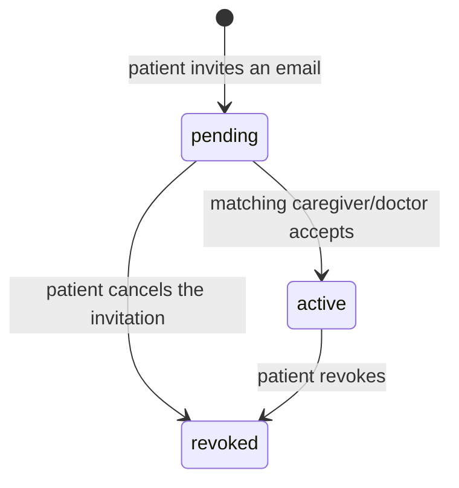

# 09. Access sharing and the audit log

Chapter 04 introduced consent at a high level. This chapter goes through the whole feature: invitations, why the
API cannot be used to find out who has an account, the "one open grant per pair" rule, how revoking works
instantly, and why every view of a patient's report is recorded **before** the data is returned.

## 1. First principles

### Consent is the patient's, and it must be reversible

Health data is sensitive. A caregiver or doctor may only see it if the patient says yes, and the patient must be
able to say no later. Two design questions follow:

1. **How does the patient say yes?** Here: by inviting an email address, and the recipient accepting.
2. **How is "no" enforced the moment it is said?** By never caching the permission. Every request asks the
   database again.

### Account enumeration

If a form behaves differently for an email that has an account and one that does not ("no such user" versus "invite
sent"), an attacker can try thousands of addresses and learn exactly who uses the service. This is called
**account enumeration**. For a *health* service the fact that someone is a user is itself private. So the rule
is: **the response must be identical whether or not the account exists.**

### Auditing

An **audit log** is an append-only record of who did what and when. For data access it answers the patient's
question "who has looked at my information?". Its value depends on being **complete**: if viewing can happen
without a record, the log is not trustworthy.

## 2. The data: `AccessGrant`

Fields and constraints are in chapter 03. The essentials:

| Field | Meaning |
|---|---|
| `patient` | Who gave consent |
| `invited_email` | The invitation is addressed to an **email**, always stored lowercase |
| `grantee` | Filled in only when a matching caregiver/doctor accepts (nullable) |
| `status` | `pending`, `active` or `revoked` |
| `created_at`, `accepted_at`, `revoked_at` | The timeline |

Constraints: one open (pending or active) grant per `(patient, invited_email)`; the email must be lowercase; an
`active` grant must have a `grantee`; a `revoked` grant must have `revoked_at`.



Revoked rows are kept as history, and the same email can be invited again later (which creates a **new** row).

## 3. The endpoints

| Who | Method and URL | What it does |
|---|---|---|
| Patient | `POST /api/access/grants/` | Invite an email |
| Patient | `GET /api/access/grants/` | List my grants (all statuses) |
| Patient | `POST /api/access/grants/<id>/revoke/` | Revoke (or cancel a pending invitation) |
| Caregiver/doctor | `GET /api/access/invitations/` | Pending invitations addressed to my email |
| Caregiver/doctor | `POST /api/access/invitations/<id>/accept/` | Accept one |
| Caregiver/doctor | `GET /api/patients/` | The patients who currently grant me access |
| Anyone with a grant | `GET /api/reports/adherence/?patient=<id>` | Read the report (chapter 10) |
| Patient | `GET /api/audit-log/` | Who viewed my data |

The patient endpoints use `IsPatient`, the other three use `IsGrantee` (chapter 04). Note that there is **no
invitation email**: the invited person has to be told out of band and then sees the invitation in their own list
(README, "Known limitations").

## 4. Inviting without enumerating accounts

*From `accounts/access_views.py`, `GrantListCreateView.post` and the fixed answer:*

```python
# One fixed answer for every valid invitation request (see grants.invite).
INVITE_DETAIL = (
    "Invitation recorded. Access starts only if that person accepts it from "
    "a caregiver or doctor account registered with this email."
)
```

```python
    @extend_schema(request=InviteSerializer, responses={202: InviteResponseSerializer})
    def post(self, request):
        serializer = InviteSerializer(data=request.data, context={"request": request})
        serializer.is_valid(raise_exception=True)
        grants.invite(request.user, serializer.validated_data["email"])
        return Response({"detail": INVITE_DETAIL}, status=status.HTTP_202_ACCEPTED)
```

Three ingredients make the endpoint existence-blind:

1. **The code path never looks up the user.** `grants.invite` (chapter 04) just creates an `AccessGrant` for an
   email string. It does not query `User` at all, so it *cannot* behave differently.
2. **The answer is one constant string** with status **202 Accepted** ("recorded", not "done").
3. **The patient's list hides the grantee while pending.** `GrantSerializer.get_grantee` returns `None` for a
   pending grant, so even listing grants does not reveal whether the email matches an account.

*From `accounts/access_serializers.py`, `GrantSerializer.get_grantee`:*

```python
    def get_grantee(self, grant):
        if grant.status == GrantStatus.PENDING or grant.grantee is None:
            return None
        return UserBriefSerializer(grant.grantee).data
```

I ran it against real data (a registered doctor and a non-existent address):

```text
invite registered vs unregistered: 202 202 | bodies identical: True
patient's grant list: [('nobody-here@example.com', 'pending', None), ('sh_doc@example.com', 'pending', None)]
invite yourself -> 400 {'email': ['You cannot invite yourself.']}
```

The only validation error, "You cannot invite yourself", depends on the patient's *own* email, which they
already know, so it leaks nothing (`InviteSerializer.validate_email`). The tests
`test_invite_response_is_identical_whether_or_not_the_account_exists` and
`test_pending_grants_look_the_same_in_the_list_regardless_of_account` pin this down. The endpoint is also rate
limited per patient (`InviteThrottle`, 20 per hour) so it cannot be used to spam addresses.

## 5. One open grant per pair

What if the patient clicks "invite" twice, or two requests arrive together? The database rule (chapter 03) is a
**partial unique constraint**: unique on `(patient, invited_email)` only while the status is `pending` or
`active`. `grants.invite` relies on it:

*From `accounts/grants.py`, `invite`:*

```python
    try:
        with transaction.atomic():
            AccessGrant.objects.create(patient=patient, invited_email=email.strip().lower())
    except IntegrityError:
        pass  # an open grant for this email already exists: nothing to do
```

A duplicate raises `IntegrityError`, which is swallowed: the caller still gets the same 202. The
`transaction.atomic()` wrapper matters: it makes the failed insert a clean savepoint so the surrounding request
transaction is not poisoned. I verified that inviting the same address twice (even with different capitalisation,
`SH_DOC@example.com` versus `sh_doc@example.com`) leaves **one** row. The email is lowercased in `grants.invite`
and a `CHECK` constraint (`grant_email_lowercase`) guarantees it in the database.

Why a *partial* unique constraint and not a plain one? After a revoke, the patient may want to invite the same
person again. A plain unique would forbid it forever. Because revoked rows fall outside the constraint's
condition, a new `pending` row is allowed and the revoked row stays as history
(`test_revoked_grantee_can_be_invited_again`). The tests `test_database_rejects_two_open_grants_for_one_pair`
and `test_simultaneous_invites_create_exactly_one_grant` (real threads) show the database, not just Python, holds
the line.

## 6. Accepting: only the person the invitation was for

*From `accounts/access_views.py`, `InvitationListView` and `InvitationAcceptView`:*

```python
    def get(self, request):
        qs = AccessGrant.objects.filter(
            invited_email=request.user.email.lower(), status=GrantStatus.PENDING
        ).select_related("patient")
        return Response(InvitationSerializer(qs, many=True).data)
```

```python
    def post(self, request, pk):
        return Response(InvitationSerializer(grants.accept(request.user, pk)).data)
```

`grants.accept` (chapter 04) looks the grant up with `invited_email=grantee.email.lower()` under a row lock, and
raises `NotFound` otherwise. So:

* The invitation list shows only invitations **addressed to your email**.
* Someone else guessing an id gets **404**: I checked that a caregiver trying to accept the doctor's invitation
  gets 404.
* A **patient** account cannot use these endpoints at all (`IsGrantee`; I got `403`).
* Accepting twice is harmless (it stays `active`), and a **revoked** invitation cannot be accepted
  (`NotFound`; I got 404) because the patient decided no.
* An invitation sent to an email that registers *later* can still be accepted, because the invitation belongs to
  the email, not to a user row (`test_invitation_to_an_email_registered_later_can_be_accepted`).

```text
caregiver (wrong email) accepts the doctor's invitation -> 404
a PATIENT account cannot use /invitations -> 403
doctor accepts -> active | accepts again -> active
doctor lists patients: ['sh_p@example.com']
```

## 7. Revocation is instant

Nothing about a grant is cached: not in the JWT, not in memory, not in the session. Every read re-checks the
database, in `accounts/access.py`:

*From `accounts/access.py`, `has_active_grant` and the module docstring:*

```python
Every check here is a live database query. Nothing is cached in memory, in
the JWT or in the session, so revoking a grant takes effect on the very next
request. Callers answer 404 (not 403) for "no access", so the API does not
reveal which patient ids exist.
```

```python
def has_active_grant(grantee, patient_id: int) -> bool:
    return _active_grants().filter(grantee=grantee, patient_id=patient_id).exists()
```

`_active_grants()` requires `status = active`, a non-null grantee whose role is caregiver or doctor, **and**
the grantee's account to be active. Revoking is one write:

*From `accounts/grants.py`, `revoke`:*

```python
    with transaction.atomic():
        grant = (
            AccessGrant.objects.select_for_update(of=("self",))
            .select_related("grantee")
            .filter(pk=grant_id, patient=patient)
            .first()
        )
        if grant is None:
            raise NotFound()
        if grant.status != GrantStatus.REVOKED:
            grant.status = GrantStatus.REVOKED
            grant.revoked_at = timezone.now()
            grant.save(update_fields=["status", "revoked_at"])
        return grant
```

* The lookup includes `patient=patient`, so a patient can only revoke **their own** grants (someone else's id is
  404; a caregiver or doctor calling this patient endpoint gets 403).
* Repeating a revoke is a no-op and keeps the *first* `revoked_at` (`test_revoking_twice_keeps_the_first_timestamp`).
* The row lock means an accept racing a revoke ends consistently: whichever commits first wins and the other
  sees the new status.

The proof, with the **same access token** before and after (from chapter 04's journey and
`test_revoking_takes_effect_on_the_very_next_request_with_the_same_token`):

```text
doctor views report       -> 200
patient revokes           -> revoked
doctor report again       -> 404 {"detail": "Not found."}
```

Revoking also stops **weekly summary emails**: `reports/summary.py` re-checks `has_active_grant` right before
sending and, if the grant is gone, marks that summary `cancelled` (the comment in the code says "revoke wins").

## 8. Resolving who the report is about

*From `accounts/access.py`, `resolve_patient` (the part for grantees):*

```python
    if viewer.role not in GRANTEE_ROLES:
        raise NotFound()
    if raw_patient_id in (None, ""):
        raise ValidationError({"patient": "This field is required."})
    try:
        patient_id = int(raw_patient_id)
    except (TypeError, ValueError):
        raise ValidationError({"patient": "Must be a whole number."})
    patient = accessible_patients(viewer).filter(pk=patient_id).select_related("patient_profile").first()
    if patient is None:
        raise NotFound()
    return patient
```

`accessible_patients(viewer)` is the set of patients with an active grant to this viewer, so asking for a patient
outside it gives the same `404` as asking for a patient that does not exist. A grant for one patient never opens
another (`test_grant_for_one_patient_does_not_open_another`). I verified: a patient asking for **another
patient's** report gets 404, while their own (no id) gets 200.

## 9. The audit log

### What is recorded

*From `reports/audit.py`:*

```python
def record_view(viewer, patient, rng, action: str = AuditAction.REPORT_VIEW) -> AuditLog:
    """Append an audit row. Raises on failure, so no data is returned unaudited."""
    return AuditLog.objects.create(
        viewer=viewer, viewer_email=viewer.email, viewer_role=viewer.role, patient=patient,
        action=action, range_start=rng.start_date, range_end=rng.end_date,
    )
```

Each row stores **who** (the viewer's email and role, copied), **whose** data, **what** (`report_view` or
`weekly_summary`), **which period** was looked at, and **when** (`created_at`, set automatically). The model
(chapter 03) is append-only: nothing in the app updates or deletes rows.

### Why it is written before the data is returned

*From `reports/views.py`, `AdherenceReportView.get`:*

```python
        patient = resolve_patient(request.user, request.query_params.get("patient"))  # 404 / 400
        now = timezone.now()
        rng = parse_query_range(request.query_params, patient_timezone(patient), now)  # 400
        if request.user.pk != patient.pk:
            audit.record_view(request.user, patient, rng)
        return Response(AdherenceReportSerializer(adherence_report(patient, rng, now)).data)
```

Look at the order. `record_view` runs **before** the report is computed and returned. If the audit write fails,
the exception propagates, the request fails, and **no data leaves the server**. The alternative order (return,
then log) has a hole: a crash, a slow database or a bug between the two steps means data was read with no record.
The docstring states the principle: "Raises on failure, so no data is returned unaudited." I tested a simulated
audit failure:

```text
audit write FAILS -> status 500 | response contains report data: False | rows added: 0
```

(`test_no_data_is_returned_if_the_audit_write_fails`.) This is a deliberate trade-off of availability for
accountability: if auditing is broken, reports are unavailable to third parties until it is fixed.

### What is and is not logged

```text
patient views own report -> audit rows added: 0
doctor: 1 good view + 1 invalid date (400) + 1 ungranted patient (404) -> audit rows added: 1
```

* **Own views are not logged**, since the log is about *other* people looking (`request.user.pk != patient.pk`;
  `test_a_patient_viewing_their_own_report_is_not_audited`).
* **Only successful third-party views are logged.** The date range is parsed and the grant resolved **before**
  `record_view`, so denied (404) and invalid (400) requests never create an entry
  (`test_denied_and_invalid_requests_are_not_logged_as_views`). Every successful view is logged, even repeats
  (`test_every_view_is_logged`).
* **Weekly summary emails to a caregiver or doctor are logged too**, with action `weekly_summary`
  (`reports/summary.py` calls `audit.record_view(recipient, patient, rng, AuditAction.WEEKLY_SUMMARY)`).

### The entry outlives the viewer

The viewer foreign key is `SET_NULL` and the email and role are copied onto the row, so the history stays
meaningful after an account is deleted (`test_audit_entry_outlives_the_viewer_account`):

```text
audit rows survive the viewer's deletion: viewer_id = None | viewer_email still = sh_doc@example.com
```

### The patient reads it

*From `reports/views.py`, `AuditLogListView`:*

```python
class AuditPagination(LimitOffsetPagination):
    default_limit = 50
    max_limit = 200
```

`GET /api/audit-log/` is `IsPatient`, filtered to `patient=request.user`, newest first, and paginated with
`limit` and `offset` (default 50, at most 200). The index `audit_patient_time_idx (patient_id, created_at DESC)`
serves exactly this query (chapter 11). A real page:

```text
{'count': 1, 'next': None, 'results': [{'action': 'report_view', 'viewer_email': 'sh_doc@example.com',
 'viewer_role': 'doctor', 'range_start': '2026-10-28', 'range_end': '2026-11-26'}]}
```

## 10. Try it yourself

```bash
pytest accounts/tests/test_access_grants.py reports/tests/test_report_api.py -v
```

Then through Swagger (`/api/docs/`): register a patient and a doctor, invite the doctor's email, accept as the
doctor, request the report, read `/api/audit-log/` as the patient, revoke, and request the report again.

## Interview questions on this chapter

1. **Q: How do you prevent account enumeration through the invite endpoint?**
   **A:** The invitation is addressed to an email, and the code path never queries the user table. Every valid
   request gets the same 202 and the same fixed message; duplicates are absorbed silently; and a pending grant
   shows no grantee in the patient's list. A registered and an unregistered address are indistinguishable.

2. **Q: What stops two open grants for the same patient and email?**
   **A:** A partial unique constraint on `(patient, invited_email)` where status is `pending` or `active`.
   `grants.invite` catches the `IntegrityError` for a duplicate and returns the same response. A test races real
   threads to prove one row results.

3. **Q: Why partial and not a plain unique constraint?**
   **A:** A plain one would block re-inviting someone after revoking. The partial constraint only covers open
   grants, so revoked rows remain as history and a fresh invitation is allowed.

4. **Q: Who can accept an invitation?**
   **A:** Only a caregiver or doctor account whose email equals the invited email. `accept` filters by
   `invited_email=grantee.email.lower()` under a row lock; anything else is a 404. A patient account is refused by
   the `IsGrantee` permission, and a revoked invitation cannot be accepted.

5. **Q: How is revocation immediate?**
   **A:** Permission is never cached or put in the JWT. `resolve_patient` queries for an active grant on every
   request, so the instant the status becomes `revoked` the next request returns 404, even with the same token.
   Weekly summaries re-check the grant right before sending.

6. **Q: Why write the audit row before returning data?**
   **A:** So viewing can never happen without a record. If the audit write fails, the request fails and no data
   is returned. Logging after the response would leave a gap where data was read but nothing recorded.

7. **Q: What is the trade-off of that choice?**
   **A:** Availability for accountability: if the audit table cannot be written, third parties cannot read
   reports. For health data I consider a complete audit trail more important, and a patient viewing their own
   data is not affected.

8. **Q: What does the audit log not record, and why?**
   **A:** A patient viewing their own report (the log is about third parties) and denied or invalid requests
   (nothing was disclosed). The range and grant checks run before `record_view`, so only successful third-party
   views and weekly-summary emails are logged.

9. **Q: Why does the audit row copy the viewer's email and role instead of just pointing at the user?**
   **A:** The viewer key is `SET_NULL`, so if the account is deleted the row survives; the copied email and role
   keep it meaningful. An audit record should not change or lose meaning when other data changes.

10. **Q: Why 404 instead of 403 when you lack a grant?**
    **A:** 403 confirms the patient exists. Returning 404 for both "no such patient" and "no grant" stops
    attackers probing ids, consistent with the existence-blind invitations.

## Common mistakes to avoid

* **Different responses for existing and non-existing accounts.** Even a different timing or message leaks.
* **Caching the permission** (in the token, a session or memory). Revocation would then lag behind.
* **Logging after returning data.** A failure in between creates unaudited access.
* **Logging denied requests as "views".** It pollutes the patient's log with events where nothing was shown.
* **Using a plain unique constraint** and then being unable to re-invite after a revoke.
* **Pointing the audit row only at a user foreign key.** Deleting the user would lose the history; copy the
  identifying facts.
* **Forgetting that the invitation list is by email.** Filtering by user id would break invitations sent before
  the person registered.
* **Assuming an invitation email is sent.** It is not; the invited person must be told another way.
