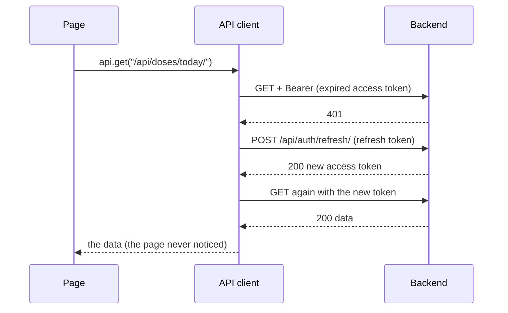

# 15. The frontend, in outline

The backend is the focus of this guide, and the backend stays **API-only** (`CLAUDE.md`). Still, interviewers
often ask "and how does the client use your API?", so this chapter explains how the React app in `frontend/`
talks to the backend: the API client, token handling and automatic refresh, role-based routes, demo mode, and
the design system. It is an overview, not a React course.

## 1. First principles

### What is a single-page app (SPA)?

A **single-page application** loads one HTML page and JavaScript once, then draws every screen in the browser.
When you click "Medications", no new page is fetched; the JavaScript changes the URL, asks the API for JSON, and
re-draws. The server only provides **data** (the JSON API) and the static files; it does not render pages.

That has consequences for security and for design:

* The browser, not the server, remembers who you are, so the **tokens must be stored somewhere** (section 3).
* Anything the frontend hides (a menu item, a page) is only **cosmetic**. A user can open the browser's developer
  tools and call the API directly. So **the backend must enforce every rule**, which it does (chapters 04 and 09).
* Because the page and the API are on different origins in development (`localhost:5173` and `localhost:8000`),
  the backend needs **CORS** (chapter 12).

### The stack (all in `frontend/package.json`)

React 18 (UI), Vite (build tool and dev server), TypeScript in strict mode (type safety), Tailwind CSS 4 (styling
with design tokens), React Router (pages), Recharts (charts, loaded lazily), and Vitest with Testing Library and
axe-core (tests). Fonts are self-hosted, so nothing loads from a CDN.

```text
frontend/src/
  api/         client.ts (HTTP + refresh), tokenStore.ts, types.ts
  auth/        AuthProvider, ProtectedRoute, context
  pages/       Landing, Login, Register, patient/*, grantee/*
  components/  ui/ (Button, Modal, Input...), layout/, charts/, doses/, medications/
  hooks/       useAsync, usePageTitle, useReducedMotion ...
  lib/         pure logic: dates, doses, medications, timezones, report
  demo/        demo-mode sign-in (only in demo builds)
  index.css    the design tokens
```

## 2. How the app calls the API

**One client** makes every request: `src/api/client.ts`. No page calls `fetch` itself. That gives one place for
headers, error handling and token refresh.

* It adds `Authorization: Bearer <access token>` to every request (except sign-in, registration and refresh).
* It parses JSON and turns every failure into an `ApiError` with a status and a readable message. For validation
  errors (HTTP 400) it exposes `fieldErrors`, flattening the shapes Django REST Framework produces (including
  nested ones such as `times_of_day: {"0": [...]}`, chapter 05), so a form can show each message under its field.
* It maps statuses to friendly messages: a network failure ("Can't reach the server"), `429` with the
  `Retry-After` wait ("Please wait 30 seconds"), `5xx` ("Something went wrong on our side"), and otherwise the API's
  own `detail` or first field message.
* The base URL comes from a build-time variable, `VITE_API_BASE_URL` (section 6).

*From `src/api/client.ts`, the app-wide instances:*

```typescript
/** The app-wide instances. Tests build their own with createTokenStore / createApiClient. */
export const tokenStore = createTokenStore()
export const api = createApiClient({
  baseUrl: import.meta.env.VITE_API_BASE_URL ?? '',
  tokens: tokenStore,
})
```

Pages use it through a small hook, `useAsync` (`src/hooks/useAsync.ts`), which tracks loading, success and error
and keeps the previous data while it reloads, so a refresh never flashes a blank screen. Every page has a loading
skeleton, an error state with a retry button, and a responsive layout.

## 3. Token handling

### Where the tokens live

After login the API returns an access token and a refresh token (chapter 04). The frontend must keep them for
requests. The options are: memory only (lost on reload), `localStorage` (survives closing the browser, shared by
every tab) or `sessionStorage` (survives a reload but not closing the tab). The code chooses **memory plus
`sessionStorage`, never `localStorage`**:

*From `src/api/tokenStore.ts`:*

```typescript
/**
 * Where the JWTs live: in memory, mirrored to sessionStorage so a page reload keeps you signed in for the
 * life of the browser tab. NEVER localStorage: it survives the browser being closed and is shared by every
 * tab, which is a much longer exposure for a bearer credential. (sessionStorage is still readable by any
 * script running on the page, so XSS remains the real threat: this app renders no untrusted HTML.)
 */
```

The honest reading: any browser storage is readable by any script on the page, so the real defence is *not
running untrusted code* (XSS prevention: the app renders no raw HTML from the server). `sessionStorage` simply
limits how long a stolen token is useful. A test (`src/theme/theme.test.ts`) fails if the source code ever
mentions `localStorage`. The store also copes with storage that throws (private browsing) by carrying on in
memory.

### The refresh dance

An access token lives 30 minutes. When it expires the API answers **401**. The client then trades the refresh
token for a new access token **once**, and retries the original request:



*From `src/api/client.ts`, the start of `refreshAccessToken`:*

```typescript
  /**
   * Exchange the refresh token for a new access token. Single-flight: if several requests hit a 401 at
   * the same time they all wait on ONE refresh call, instead of each spending the refresh token.
   */
  function refreshAccessToken(): Promise<boolean> {
    if (refreshInFlight) return refreshInFlight
    const refresh = tokens.get()?.refresh
    if (!refresh) return Promise.resolve(false)
```

*From `src/api/client.ts`, the end of `refreshAccessToken`:*

```typescript
    refreshInFlight = attempt
    void attempt.finally(() => {
      refreshInFlight = null
    })
    return attempt
```

*From `src/api/client.ts`, `request`:*

```typescript
    let response = await attemptOnce()

    if (response.status === 401 && auth && tokens.get()) {
      if (!(await refreshAccessToken())) {
        expireSession()
        throw await toError(response)
      }
      response = await attemptOnce() // exactly one retry, now with the new access token
      if (response.status === 401) {
        expireSession() // a freshly issued token was refused: this session cannot be used
        throw await toError(response)
      }
```

The details that matter:

* **Single-flight.** A page often fires several requests at once. If all got a 401 and each tried to refresh,
  they would race. `refreshInFlight` makes them all wait for **one** refresh call.
* **Exactly one retry.** If the retry is also refused, the session is ended: it cannot be saved.
* **Sign-in, register and refresh never trigger a refresh.** They pass `auth: false`; a 401 there means "wrong
  credentials", not "expired session".
* **When the session ends**, `expireSession()` clears the tokens and notifies the app, which shows the sign-in page
  and a "Your session ended" notice (`AuthProvider` subscribes with `onSessionExpired`).
* The backend does not rotate refresh tokens (chapter 04), and the client copes: "The server may rotate the
  refresh token; if it does not, keep the one we have."
* There is **no server-side sign-out** (the backend has no blacklist), so signing out only forgets the tokens in
  the browser.

### Logging in

*From `src/auth/AuthProvider.tsx`, `login`:*

```typescript
  const login = useCallback(
    async (email: string, password: string) => {
      const pair = await client.post<TokenPair>('/api/auth/login/', { email, password }, { auth: false })
      tokens.set(pair)
      try {
        const me = await client.get<Me>('/api/me/')
        setUser(me)
        setStatus('authenticated')
        return me
      } catch (error) {
        tokens.clear()
        throw error
      }
    },
    [client, tokens],
  )
```

Log in to get tokens, store them, then ask `GET /api/me/` who you are (including your **role**). If that second
call fails, the tokens are cleared again so the app never sits half signed in. On startup, if a saved session
exists, the provider calls `/api/me/` before deciding what to show (the status is `loading` until then).

## 4. Role-based routes

The backend has three roles, and the app shows different screens to each: patients get Today, Upcoming,
Medications, Sharing and Activity; caregivers and doctors get Patients (and a report page) and Invitations.

*From `src/auth/ProtectedRoute.tsx`:*

```typescript
export function ProtectedRoute({ roles }: { roles?: Role[] }) {
  const { status, user } = useAuth()
  const location = useLocation()

  if (status === 'loading') {
    return (
      <div role="status" className="flex min-h-[40vh] items-center justify-center gap-3 text-ink">
        <Spinner />
        <span>Loading your account…</span>
      </div>
    )
  }
  if (status !== 'authenticated' || !user) {
    return <Navigate to="/login" replace state={{ from: `${location.pathname}${location.search}` }} />
  }
  if (roles && !roles.includes(user.role)) return <ForbiddenPage />
  return <Outlet />
}
```

*From `src/App.tsx`, the route table:*

```typescript
      {/* Everything below needs a signed-in user and gets the app shell. */}
      <Route element={<ProtectedRoute />}>
        <Route element={<AppShell />}>
          <Route element={<ProtectedRoute roles={['patient']} />}>
            <Route path="/today" element={<TodayPage />} />
            <Route path="/upcoming" element={<UpcomingPage />} />
            <Route path="/medications" element={<MedicationsPage />} />
            <Route path="/medications/new" element={<NewMedicationPage />} />
            <Route path="/medications/:id/edit" element={<EditMedicationPage />} />
            <Route path="/sharing" element={<SharingPage />} />
            <Route path="/activity" element={<ActivityPage />} />
          </Route>

          <Route element={<ProtectedRoute roles={['caregiver', 'doctor']} />}>
            <Route path="/patients" element={<PatientsPage />} />
            <Route path="/patients/:patientId" element={<ReportPage />} />
            <Route path="/invitations" element={<InvitationsPage />} />
          </Route>
```

How to read it:

* Not signed in: go to `/login` and **remember where you were going**, so after signing in you land there.
* Wrong role (a patient opening `/patients`): a calm "not available to your account" page.
* **This is only presentation.** The comment in the file says so: "This only decides what the UI shows. The backend
  enforces the same rules on every request." A patient forcing a call to `/api/patients/` gets a 403 from the API
  anyway (chapter 04).
* An unknown address shows a friendly 404 (inside the app shell if signed in); `/` shows a landing page to
  visitors and sends signed-in people to their home.

### Showing the "no access" state

A report for a revoked or unknown patient makes the API answer 404 (chapter 09). The report page treats any 404 (and
a malformed patient id) as a calm "This report isn't available" message with a way back, never an error screen.

### Optimistic updates

On the Today page, pressing **Taken** updates the screen immediately, then confirms with the server
(`POST /api/doses/<id>/taken/`). If the server refuses, the change is rolled back with a "Try again" toast. A
`409` (for example skipping a dose that was already taken) becomes a plain sentence and a quiet refresh. There is
**no undo**, because the API treats taken and skipped as final (chapter 08).

## 5. Demo mode

For trying the app quickly, the sign-in page can show four buttons ("Try as patient (Kolkata)", "Try as patient
(New York)", "Try as caregiver", "Try as doctor") that sign in with the accounts created by
`python manage.py seed_demo`. It is for **local development only**.

The safety rule is that demo mode must **not exist at all** in a build where the variable is not set. The whole
switch is one expression:

*From `src/demo/DemoSection.tsx`:*

```typescript
const DemoLogin = import.meta.env.VITE_DEMO_MODE === 'true' ? lazy(() => import('./DemoLogin')) : null

export function DemoSection() {
  if (!DemoLogin) return null
  return (
    <Suspense fallback={null}>
      <DemoLogin />
    </Suspense>
  )
}
```

Vite **replaces** `import.meta.env.VITE_DEMO_MODE` with a literal text when it builds. Without the flag the
condition is `"false" === 'true'`, the compiler removes the dead branch, and the demo component, its labels and the
demo password never reach the downloadable JavaScript. This is proven by a test, `src/demo/demoStripped.test.ts`,
which runs real production builds with the flag unset, `false`, `TRUE` and `1`, searches the output for the demo
text and fails if any is found, and builds once with `true` to prove the search can find it.

Settings in `frontend/.env.example`:

```text
VITE_API_BASE_URL=http://localhost:8000
VITE_DEMO_MODE=false
VITE_DEMO_PASSWORD=demo-password-123
VITE_DEMO_PATIENT_KOLKATA_EMAIL=demo.asha@example.com
VITE_DEMO_PATIENT_NEW_YORK_EMAIL=demo.ben@example.com
VITE_DEMO_CAREGIVER_EMAIL=demo.carla@example.com
VITE_DEMO_DOCTOR_EMAIL=demo.dr.rao@example.com
```

`VITE_` variables are **compiled into** the public JavaScript, so never put a secret in one. The demo password is
the documented public development default of `seed_demo`, not a secret, and it is only read in a demo build.

## 6. Running and building

```bash
cd frontend
cp .env.example .env.local     # edit VITE_API_BASE_URL if your backend is elsewhere
npm ci
npm run dev                    # http://localhost:5173
```

The backend must allow that origin: set `CORS_ALLOWED_ORIGINS=http://localhost:5173` in the backend `.env`
(chapter 12). The other scripts (`frontend/package.json`): `npm run lint` (ESLint, no warnings allowed),
`npm run typecheck`, `npm test` (Vitest), `npm run build` (type-check then a production build), `npm run preview`
(serve the build on port 4173). I ran the suite: **450 tests in 31 files**.

## 7. The design system

The look is calm "sage and cream", defined **once** as design tokens in `src/index.css`. Tailwind's default
palette is removed (`--color-*: initial`), so a class like `bg-blue-500` does not exist.

*From `src/index.css`, `@theme static`:*

```css
  --color-cream: #faf7f0; /* page background */
  --color-surface: #ffffff; /* cards, inputs */
  --color-subtle: #f3efe4; /* quiet fills */
  --color-sage: #6b8f71; /* brand: accents, charts, control borders (3.6:1 on white) */
  --color-sage-dark: #4a6b50; /* primary actions, hover, text on light backgrounds */
  --color-sage-tint: #e4ede3; /* selected / success fill */
  --color-ink: #2b2f2a; /* body text */
  --color-muted: #6e756c; /* secondary text, on white surfaces only */
  --color-line: #e6e1d6; /* decorative borders and dividers */
  --color-clay: #c98b6b; /* missed / needs attention (fill, with ink text) */
  --color-danger: #b5483f; /* errors and destructive actions */
```

Decisions that come from **contrast** (WCAG AA wants 4.5:1 for normal text, 3:1 for large text and controls):

| Rule | Reason |
|---|---|
| Filled buttons use `sage-dark` with white text | White on `sage` is only 3.63:1; on `sage-dark` it is 6.0:1 |
| `muted` text only on white surfaces | On cream it is 4.44:1 and on `subtle` 4.13:1, below AA |
| `clay` and plain `sage` are never text colours | Both are under 4.5:1 on light backgrounds; they are fills and borders |
| Status chips always carry a **word** ("Missed", "Taken late") | Meaning is never carried by colour alone |

A test (`src/theme/theme.test.ts`) enforces the palette, computes these contrast ratios, bans default colours and
hard-coded hex values, and lists which files may use `muted`. Accessibility also includes: one `<h1>` per page,
a skip link, focus moved to the new page content after navigation and to the first invalid field after a failed
submit, dialogs with a focus trap, `role="alert"` and `role="status"` messages, per-page titles, and
`prefers-reduced-motion` respected (animations, count-up and press feedback are off for people who ask for less
motion). Axe ran with real colour contrast in a browser on every page at desktop and phone width.

## 8. What to say about the frontend in an interview

* "The frontend is a React single-page app that uses only the public API; no backend change was needed except
  CORS."
* "One API client handles auth, errors and a **single-flight token refresh**."
* "Tokens live in memory and `sessionStorage`, never `localStorage`; the real protection is no untrusted HTML."
* "Role-based routes are cosmetic; the backend enforces every rule."
* "Demo mode is compiled out of normal builds, and a test builds the app to prove it."

## Interview questions on this chapter

1. **Q: How does the frontend authenticate to your API?**
   **A:** It logs in at `/api/auth/login/`, stores the access and refresh tokens, and sends the access token as
   `Authorization: Bearer ...` on every request through one API client. After login it calls `/api/me/` to learn
   the user's role and profile.

2. **Q: What happens when the access token expires?**
   **A:** The API returns 401. The client exchanges the refresh token for a new access token once and retries the
   original request. Concurrent requests share one refresh call (single-flight). If the refresh fails, or the
   retry is refused again, the session is ended and the user sees the sign-in page.

3. **Q: Where do you store the tokens and why?**
   **A:** In memory, mirrored to `sessionStorage`, never `localStorage`. A reload keeps you signed in, but closing
   the tab ends the session, a shorter exposure than `localStorage`. Any script on the page can read either, so
   the real defence is preventing XSS; the app renders no untrusted HTML.

4. **Q: Are role-based routes a security feature?**
   **A:** No. They only decide what the UI shows. Someone can call the API directly, so the backend checks the
   role and ownership on every request, which it does with permission classes and scoped querysets.

5. **Q: Why is a single-flight refresh important?**
   **A:** A page usually sends several requests at once. If they all get a 401 and each refreshes, they race and
   waste the refresh token. Sharing one in-flight refresh promise makes them all wait and then retry with the same
   new token.

6. **Q: How do you make sure demo credentials never ship in a production build?**
   **A:** Demo mode is one compile-time expression on `VITE_DEMO_MODE`. Without the flag the bundler removes the
   dynamic import, so the component and the demo password are not in the output. A test builds the app with the
   flag unset, `false`, `TRUE` and `1` and searches the output; a build with the flag on proves the search works.

7. **Q: How do you show field errors from the API?**
   **A:** The client turns a 400 into an `ApiError` whose `fieldErrors` flattens DRF's shapes (strings, lists and
   nested objects) to the first message per field. The form maps that to inputs and moves focus to the first
   invalid one.

8. **Q: Why optimistic updates, and what about failures?**
   **A:** They make the app feel instant. The UI changes first and the request follows; on failure the change is
   rolled back with a "Try again" action. A 409 shows a plain message and refreshes quietly. There is no undo
   because the API treats taken and skipped as final.

9. **Q: Why design tokens and a contrast test?**
   **A:** One source of truth for colours keeps the look consistent, and a test that computes contrast ratios
   stops someone introducing text that fails accessibility, such as white on the brand sage (3.63:1).

10. **Q: What does CORS have to do with the frontend?**
    **A:** In development the app and the API are different origins, and browsers block reading responses unless
    the API allows the origin. The backend allow-lists the frontend origin from an environment variable, exposes
    only `/api/`, and exposes `Retry-After`; there are no cookies, so credentials are not allowed.

## Common mistakes to avoid

* **Treating hidden buttons or routes as security.** Enforce on the server.
* **Storing tokens in `localStorage` by habit.** Choose deliberately and explain the trade-off.
* **Refreshing tokens from several places at once.** Use one single-flight function.
* **Retrying forever on 401.** One retry, then end the session.
* **Putting secrets in `VITE_` variables.** They are public.
* **Letting demo-only code ship.** Compile it out, and test that it is gone.
* **Using colour alone to carry meaning**, or text colours that fail contrast.
* **Showing raw API errors.** Map statuses to friendly messages and field errors to inputs.
* **Calling `fetch` from every component.** One client means one place to fix behaviour.
